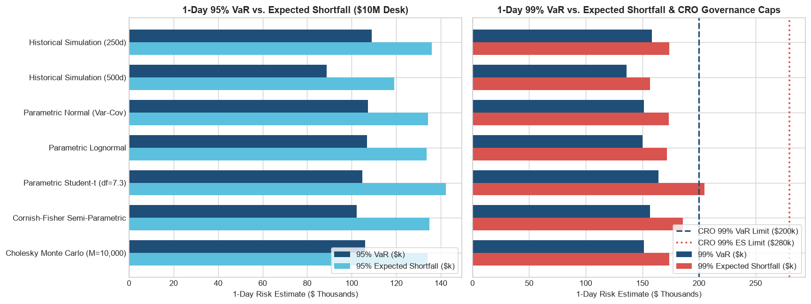
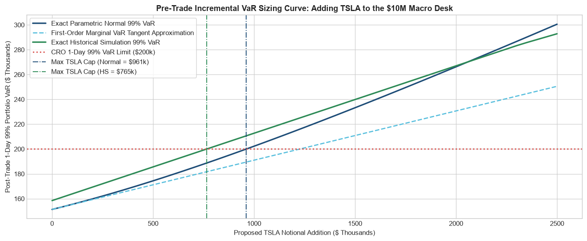
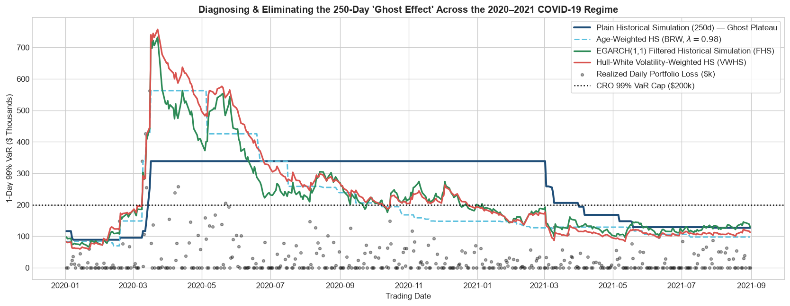
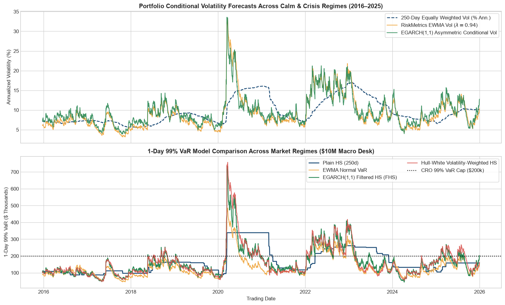
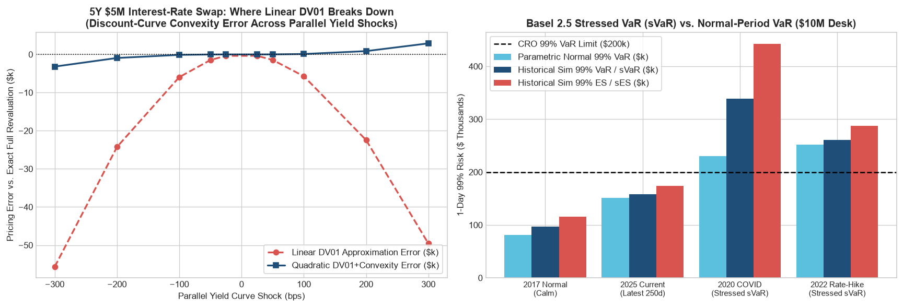
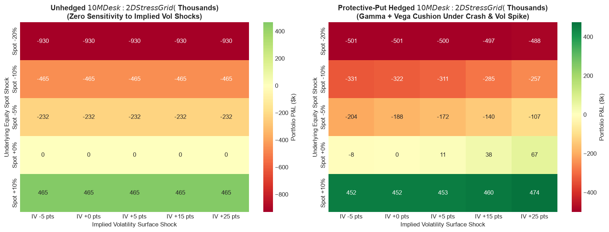

# Multi-Asset VaR and ES Engine with Backtesting and Derivatives Revaluation — Technical Whitepaper

## 1. Trading Desk Governance Mandate, System Architecture and Point-in-Time Data Engineering

### 1.1 Institutional Trading Desk Mandate and Risk Governance Limits across Equity, Rates, FX and Gold

Quantitative risk management within an institutional multi-asset trading operation exists to enforce capital allocation discipline, size pre-trade exposures, and preserve solvency across tranquil and stressed market regimes. Rather than treating risk metrics as abstract statistical outputs, the risk engine documented in this technical whitepaper governs a **USD 10,000,000 Multi-Asset Macro Trading Desk** defined in [`config/portfolio.yaml`](file:///Users/mukundankit/Documents/Finance/market_risk_modelling/config/portfolio.yaml). The desk supports both a 4-asset core macro book (`SPY` 30%, `AAPL` 20%, `TLT` 30%, `GLD` 20%) and a 5-asset FX-inclusive cross-asset sleeve incorporating **Foreign Exchange (`FXE` / Spot `EUR/USD`)** alongside US Equities (`SPY`, `AAPL`), Sovereign Interest Rates (`TLT`), and Safe-Haven Gold (`GLD`), as well as pre-trade tactical additions in volatile single-stock equities (**Tesla Inc., `TSLA`**) and non-linear derivatives (`SPY` options and a **USD 5,000,000 5-Year Pay-Fixed USD Interest-Rate Swap**).

| Asset Ticker | Asset Class & Risk Factor Role | Core 4-Asset Weight | Extended FX-Macro Weight | Primary Risk Sensitivity |
| :--- | :--- | :---: | :---: | :--- |
| **SPY** | US Large-Cap Equities (S&P 500 Index ETF) | 30.0% ($3.0M) | 30.0% ($3.0M) | Broad US Equity Beta & Implied Volatility (VIX) |
| **AAPL** | US Technology Single-Stock Equity (Apple Inc.) | 20.0% ($2.0M) | 15.0% ($1.5M) | Equity Beta + Idiosyncratic Single-Stock Tail Risk |
| **TLT** | US Long-Duration Sovereign Bonds (20+ Yr Treasury ETF) | 30.0% ($3.0M) | 25.0% ($2.5M) | Long-End Treasury Yield Duration & Term Premium |
| **FXE** | Foreign Exchange Risk Factor (CurrencyShares Euro / EURUSD) | — | 15.0% ($1.5M) | G10 Foreign Exchange Spot Rate & Interest Differential |
| **GLD** | Precious Metals / Safe-Haven Commodity (Gold Trust) | 20.0% ($2.0M) | 15.0% ($1.5M) | Real Interest Rates, USD & Geopolitical Tail Hedge |
| **Total Portfolio** | **Multi-Asset Macro Trading Book** | **100.0% ($10.0M)** | **100.0% ($10.0M)** | **Cross-Asset Volatility & Correlation Regimes** |

The Chief Risk Officer (CRO) enforces two binding daily governance limits over a 1-trading-day holding period ($\Delta t = 1\text{ day}$) at the $\alpha = 99\%$ confidence level, in alignment with the [Basel Committee on Banking Supervision (BCBS) Market Risk Framework](https://www.bis.org/bcbs/publ/d457.htm):
1. **1-Day 99% Value-at-Risk (VaR) Limit:** $\text{VaR}_{0.99, 1\text{d}} \le \text{USD } 200,000$ ($2.00\%$ of portfolio Net Asset Value).
2. **1-Day 99% Expected Shortfall (ES) Limit:** $\text{ES}_{0.99, 1\text{d}} \le \text{USD } 280,000$ ($2.80\%$ of portfolio Net Asset Value).

These two limits drive three daily operational decisions across the progression of the framework. First, the engine monitors daily risk utilization to diagnose whether limit breaches arise from asset-specific volatility surges or from a structural breakdown in cross-asset correlations. Second, when a portfolio manager proposes adding a high-volatility position such as `TSLA`, the engine computes the exact Marginal and Incremental VaR to cap the maximum allowable trade size before execution. Third, the Model Validation Committee subjects competing parametric, non-parametric, and time-series estimators to out-of-sample statistical backtesting over 1,500 trading days to select a regulatory champion model that adapts rapidly during crisis onset without incurring Basel Traffic Light capital surcharges.

### 1.2 Hybrid Python and C++17 Quantitative System Architecture

A central architectural design principle of this framework is the separation of high-level econometric orchestration, data engineering, and visualization in **Python 3.13** from compute-intensive numerical pricing, root-finding, and time-series recursion in a **compiled C++17 shared-library kernel** ([`src/cpp/quant_core.cpp`](file:///Users/mukundankit/Documents/Finance/market_risk_modelling/src/cpp/quant_core.cpp) bound via [`src/cpp_kernel.py`](file:///Users/mukundankit/Documents/Finance/market_risk_modelling/src/cpp_kernel.py)). In institutional quantitative libraries, research analysts inspect results through interactive notebooks, but inner-loop calculations—such as repricing an option book across $M = 20,000$ joint spot-volatility Monte Carlo scenarios or iterating exponentially weighted moving average (EWMA) variance recursions—must execute at native compiled speed.

| Architectural Layer | Source Module / File | Core Responsibilities & Mathematical Scope |
| :--- | :--- | :--- |
| **Governance Configuration** | [`config/portfolio.yaml`](file:///Users/mukundankit/Documents/Finance/market_risk_modelling/config/portfolio.yaml) | Stores portfolio weights (core 4-asset & 5-asset FX-macro), $10M notional, CRO VaR/ES limits, lookback windows, decay factors, 5Y IRS parameters, and stress grids. |
| **Native C++17 Kernel** | [`src/cpp/quant_core.cpp`](file:///Users/mukundankit/Documents/Finance/market_risk_modelling/src/cpp/quant_core.cpp) [`src/cpp_kernel.py`](file:///Users/mukundankit/Documents/Finance/market_risk_modelling/src/cpp_kernel.py) | Compiled with `-O3 -std=c++17 -shared -fPIC`; executes Black-Scholes-Merton pricing, analytical Greeks, safeguarded Newton-Bisection implied volatility inversion, vectorized Full Revaluation Monte Carlo, and EWMA recursion. |
| **Data & Point-in-Time Pipeline** | [`src/data_loader.py`](file:///Users/mukundankit/Documents/Finance/market_risk_modelling/src/data_loader.py) | Extracts total-return adjusted closes across Equities (`SPY`, `AAPL`, `TSLA`), Rates (`TLT`), FX (`FXE`), and Gold (`GLD`), aligns NYSE trading calendars, caches Apache Parquet matrices (`data/raw/` and `data/processed/`), and enforces strict $\mathcal{F}_{t-1}$ point-in-time slicing. |
| **Phase 0: EDA & Stylized Facts** | [`src/eda_diagnostics.py`](file:///Users/mukundankit/Documents/Finance/market_risk_modelling/src/eda_diagnostics.py) [`00_data_hygiene_and_eda.ipynb`](file:///Users/mukundankit/Documents/Finance/market_risk_modelling/notebooks/00_data_hygiene_and_eda.ipynb) | Runs Augmented Dickey-Fuller (ADF) unit-root tests, Jarque-Bera normality tests, sample moment and tail-frequency diagnostics, Q-Q plots, and rolling regime correlation analysis. |
| **Phase 1: Baseline VaR & ES** | [`src/var_estimators.py`](file:///Users/mukundankit/Documents/Finance/market_risk_modelling/src/var_estimators.py) [`01_baseline_var_and_es.ipynb`](file:///Users/mukundankit/Documents/Finance/market_risk_modelling/notebooks/01_baseline_var_and_es.ipynb) | Implements Plain Historical Simulation (with bootstrap SE), Parametric Normal, Lognormal, MLE Student-$t$, Cornish-Fisher, Cholesky Monte Carlo, subadditivity proofs, and `TSLA` Marginal VaR trade sizing. |
| **Phase 2: Volatility Regimes & EGARCH FHS** | [`src/volatility_models.py`](file:///Users/mukundankit/Documents/Finance/market_risk_modelling/src/volatility_models.py) [`02_volatility_regimes_and_ewma_garch.ipynb`](file:///Users/mukundankit/Documents/Finance/market_risk_modelling/notebooks/02_volatility_regimes_and_ewma_garch.ipynb) | Diagnoses the 250-day "Ghost Effect"; implements RiskMetrics EWMA ($\lambda=0.94$), $\text{GARCH}(1,1)$ (Normal & Student-$t$), asymmetric **$\text{EGARCH}(1,1)$ Filtered Historical Simulation (FHS)**, Age-Weighted HS (BRW), and Hull-White Volatility-Weighted HS. |
| **Phase 3: Model Backtesting** | [`src/backtesting.py`](file:///Users/mukundankit/Documents/Finance/market_risk_modelling/src/backtesting.py) [`03_model_backtesting_and_validation.ipynb`](file:///Users/mukundankit/Documents/Finance/market_risk_modelling/notebooks/03_model_backtesting_and_validation.ipynb) | Evaluates 1,500 out-of-sample trading days across Basel Traffic Light zones, Kupiec POF unconditional coverage ($LR_{UC}$), and Christoffersen Markov independence & conditional coverage ($LR_{IND}, LR_{CC}$). |
| **Phase 4: Derivatives, IRS & Stressed VaR** | [`src/derivatives_stress.py`](file:///Users/mukundankit/Documents/Finance/market_risk_modelling/src/derivatives_stress.py) [`04_derivatives_and_stress_testing.ipynb`](file:///Users/mukundankit/Documents/Finance/market_risk_modelling/notebooks/04_derivatives_and_stress_testing.ipynb) | Evaluates `SPY` option volatility skew, analytical Greeks, 5-Year USD Interest-Rate Swap valuation & DV01/Convexity breakdown, Delta-Normal vs. Delta-Gamma-Vega vs. Full Revaluation MC, **Basel 2.5 Stressed VaR ($\text{sVaR}$)**, 2020/2022 crisis replays, and $5 \times 5$ stress grids. |
| **End-to-End Master Showcase** | [`05_end_to_end_var_es_backtesting_derivatives_showcase.ipynb`](file:///Users/mukundankit/Documents/Finance/market_risk_modelling/notebooks/05_end_to_end_var_es_backtesting_derivatives_showcase.ipynb) | Runs all four phases (Multi-Asset Data, VaR/ES + EGARCH FHS, Backtesting, and Options + Swap Revaluation + Stressed VaR) in a single unified showcase notebook. |
| **Automated Verification** | [`tests/test_risk_engine.py`](file:///Users/mukundankit/Documents/Finance/market_risk_modelling/tests/test_risk_engine.py) | Verifies closed-form mathematical identities, put-call parity, zero look-ahead slicing, subadditivity counterexamples, EGARCH FHS, 5Y IRS convexity, Stressed VaR, and backtesting discrimination via `pytest`. |

### 1.3 Data Hygiene Rules, Return Transformations and Zero Look-Ahead Slicing

Quantitative risk models are highly sensitive to data corruption. Unadjusted stock splits or dividend distributions create artificial single-day price drops that corrupt empirical tail quantiles and inflate GARCH variance parameters. To guarantee institutional data integrity, [`src/data_loader.py`](file:///Users/mukundankit/Documents/Finance/market_risk_modelling/src/data_loader.py) enforces three mandatory data hygiene rules across the 11-year historical sample spanning **January 1, 2015 to December 31, 2025** ($N = 2,797$ aligned daily return observations across `SPY`, `AAPL`, `TLT`, `GLD`, `TSLA`, `FXE`, and the [Cboe Volatility Index (`VIX`)](https://www.cboe.com/tradable_products/vix/)).

First, all asset price series use **Total-Return Adjusted Close (`Adj Close`)** prices so that corporate actions, cash dividends, and split adjustments are smoothly incorporated into the total return index. Second, all asset prices and the Cboe VIX index are inner-joined on common NYSE trading dates, allowing at most 1 consecutive trading day of forward-filling (`max_ffill_days: 1`) before computing returns. Third, every risk forecast $\text{VaR}_{\alpha, t}$ or conditional volatility parameter $\hat{\sigma}_{t \mid t-1}$ generated for trading date $t$ is strictly conditioned on the historical information set up to the close of trading day $t-1$, denoted $\mathcal{F}_{t-1} = \{r_1, r_2, \dots, r_{t-1}\}$. In [`src/data_loader.py`](file:///Users/mukundankit/Documents/Finance/market_risk_modelling/src/data_loader.py), the helper function `slice_point_in_time(df, target_date, lookback_days)` enforces the strict inequality `df.index < pd.Timestamp(target_date)` so that contemporaneous return realizations on day $t$ can never leak into ex-ante risk forecasts.

The pipeline computes and stores both daily **arithmetic (simple) returns** $r_{i,t}$ and **geometric (continuously compounded log) returns** $R_{i,t}$ for each asset $i \in \{1, \dots, N\}$:

$$r_{i,t} = \frac{P_{i,t} - P_{i,t-1}}{P_{i,t-1}}, \qquad R_{i,t} = \ln\left(\frac{P_{i,t}}{P_{i,t-1}}\right) = \ln(1 + r_{i,t})$$

Distinguishing between arithmetic and log returns is essential because each representation satisfies a different aggregation identity. **Geometric log returns aggregate additively across time**, meaning that the multi-period cumulative log return from $t=0$ to $t=T$ equals the sum of single-period log returns:

$$\sum_{t=1}^{T} R_{i,t} = \sum_{t=1}^{T} \ln\left(\frac{P_{i,t}}{P_{i,t-1}}\right) = \ln\left(\frac{P_{i,T}}{P_{i,0}}\right) \implies \frac{P_{i,T}}{P_{i,0}} = \exp\left(\sum_{t=1}^{T} R_{i,t}\right)$$

Conversely, log returns do *not* aggregate linearly across assets in a portfolio because the logarithm of a weighted sum is not equal to the weighted sum of logarithms. **Arithmetic returns aggregate linearly across the cross-section of portfolio holdings**, so the exact daily percentage return $r_{p,t}$ and dollar Profit-and-Loss ($\text{P\&L}_t$) of a portfolio with fixed beginning-of-day weights $w_i$ ($\sum_{i=1}^N w_i = 1$) and notional value $V_0$ are given by:

$$r_{p,t} = \sum_{i=1}^{N} w_i r_{i,t} = \mathbf{w}^\top \mathbf{r}_t, \qquad \text{P\&L}_t = V_0 r_{p,t}, \qquad L_t = -\text{P\&L}_t = -V_0 r_{p,t}$$

where $L_t$ denotes the daily **portfolio dollar loss** (positive values of $L_t$ represent financial losses, and negative values represent gains). In [`notebooks/00_data_hygiene_and_eda.ipynb`](file:///Users/mukundankit/Documents/Finance/market_risk_modelling/notebooks/00_data_hygiene_and_eda.ipynb) and [`tests/test_risk_engine.py`](file:///Users/mukundankit/Documents/Finance/market_risk_modelling/tests/test_risk_engine.py), both identities are verified across the 2,797-day matrix to machine precision, yielding a maximum multi-period log-return additivity error of $7.11 \times 10^{-15}$ and a maximum cross-sectional portfolio linearity error of $0.00 \times 10^0$.

## 2. Phase 0: Exploratory Data Analysis, Stationarity and Distributional Stylized Facts

### 2.1 Unit Root Testing and Time-Series Stationarity Verification

Before estimating sample covariance matrices, empirical quantiles, or GARCH conditional variance equations, a quantitative modeller must verify that the underlying time series is covariance-stationary. A stochastic process $\{Y_t\}$ is weakly (covariance) stationary if its unconditional mean $\mathbb{E}[Y_t] = \mu$ and unconditional variance $\text{Var}(Y_t) = \sigma^2 < \infty$ are constant over time, and its autocovariance $\text{Cov}(Y_t, Y_{t-k}) = \gamma_k$ depends solely on the lag $k$ rather than calendar time $t$. If a risk estimator is applied directly to a non-stationary random walk with drift, $P_t = \mu + P_{t-1} + \varepsilon_t$, the sample variance grows linearly with the sample horizon ($t \sigma_\varepsilon^2$), rendering historical quantiles and volatility estimates spurious.

To test for stationarity formally, [`src/eda_diagnostics.py`](file:///Users/mukundankit/Documents/Finance/market_risk_modelling/src/eda_diagnostics.py) applies the **Augmented Dickey-Fuller (ADF) test** ([Dickey and Fuller, 1979](https://doi.org/10.2307/2286348)) to both the raw Adjusted Close price levels ($P_{i,t}$) and the daily arithmetic return series ($r_{i,t}$) for each core asset. The ADF regression estimates:

$$\Delta Y_t = \alpha + \gamma Y_{t-1} + \sum_{j=1}^{p^*} \delta_j \Delta Y_{t-j} + u_t$$

where the lag order $p^*$ is selected automatically by minimizing the Akaike Information Criterion (AIC). The null hypothesis $\mathcal{H}_0: \gamma = 0$ posits that the series contains a unit root (integrated of order one, $I(1)$, and therefore non-stationary), against the one-sided stationary alternative $\mathcal{H}_1: \gamma < 0$ ($I(0)$).

| Asset Ticker | Tested Time Series | ADF Test Statistic ($\tau$) | MacKinnon $p$-Value | AIC Lags Used ($p^*$) | 1% Critical Value | 5% Critical Value | Stationary at 5% ($\mathcal{H}_0$ Rejected) |
| :--- | :--- | :---: | :---: | :---: | :---: | :---: | :---: |
| **SPY** | Price Level ($P_t$) | -1.7821 | $3.8936 \times 10^{-1}$ | 28 | -3.4327 | -2.8626 | **False** (Unit Root) |
| **SPY** | Daily Return ($r_t$) | -10.1509 | $7.9565 \times 10^{-18}$ | 27 | -3.4327 | -2.8626 | **True** ($I(0)$ Stationary) |
| **AAPL** | Price Level ($P_t$) | -0.4297 | $9.0503 \times 10^{-1}$ | 9 | -3.4327 | -2.8626 | **False** (Unit Root) |
| **AAPL** | Daily Return ($r_t$) | -17.9573 | $2.8250 \times 10^{-30}$ | 11 | -3.4327 | -2.8626 | **True** ($I(0)$ Stationary) |
| **TLT** | Price Level ($P_t$) | -0.9157 | $7.8276 \times 10^{-1}$ | 28 | -3.4327 | -2.8626 | **False** (Unit Root) |
| **TLT** | Daily Return ($r_t$) | -9.6586 | $1.3731 \times 10^{-16}$ | 27 | -3.4327 | -2.8626 | **True** ($I(0)$ Stationary) |
| **GLD** | Price Level ($P_t$) | -1.1812 | $6.8162 \times 10^{-1}$ | 28 | -3.4327 | -2.8626 | **False** (Unit Root) |
| **GLD** | Daily Return ($r_t$) | -13.9086 | $5.5648 \times 10^{-26}$ | 12 | -3.4327 | -2.8626 | **True** ($I(0)$ Stationary) |

As reported in the table above (extracted from [`00_data_hygiene_and_eda.ipynb`](file:///Users/mukundankit/Documents/Finance/market_risk_modelling/notebooks/00_data_hygiene_and_eda.ipynb)), every raw price series yields an ADF test statistic well above (less negative than) the 5% critical value of $-2.8626$, with $p$-values ranging from $0.389$ (`SPY`) to $0.905$ (`AAPL`). Consequently, price levels cannot be rejected as unit-root processes. Once transformed into daily percentage returns $r_{i,t}$, the ADF test statistics plunge between $-9.66$ (`TLT`) and $-17.96$ (`AAPL`), rejecting the unit-root null hypothesis at $p < 10^{-15}$ across all four assets. This empirical result establishes the econometric foundation for modeling daily returns rather than price levels in Phases 1 through 4.

### 2.2 Higher-Moment Stylized Facts: Leptokurtosis, Negative Skewness and Jarque-Bera Normality Rejection

Classical portfolio theory and baseline RiskMetrics variance-covariance models assume that daily asset returns follow a multivariate Gaussian distribution, $\mathbf{r}_t \sim \mathcal{N}(\boldsymbol{\mu}, \mathbf{\Sigma})$. Under a univariate Gaussian assumption $r_t \sim \mathcal{N}(\mu, \sigma^2)$, the third standardized moment (skewness $S$) and fourth standardized moment (kurtosis $K$) satisfy:

$$S = \mathbb{E}\left[\left(\frac{r_t - \mu}{\sigma}\right)^3\right] = 0, \qquad K = \mathbb{E}\left[\left(\frac{r_t - \mu}{\sigma}\right)^4\right] = 3, \qquad K_{\text{excess}} = K - 3 = 0$$

Furthermore, under a standard normal distribution, the two-sided probability of observing a daily return shock exceeding three standard deviations ($|z_t| = |(r_t - \mu)/\sigma| > 3.0$) is only $2 \times [1 - \Phi(3.0)] = 0.0026998$ ($0.270\%$), or roughly once every $370$ trading days (~1.5 years). To test whether empirical asset and portfolio returns conform to this Gaussian benchmark, [`src/eda_diagnostics.py`](file:///Users/mukundankit/Documents/Finance/market_risk_modelling/src/eda_diagnostics.py) computes the unbiased sample moments, the empirical frequency of $>3\sigma$ tail events, and the **Jarque-Bera (JB) test statistic** ([Jarque and Bera, 1987](https://doi.org/10.2307/1403192)):

$$\text{JB} = \frac{N}{6}\left(\hat{S}^2 + \frac{\hat{K}_{\text{excess}}^2}{4}\right) \xrightarrow{d} \chi^2_2 \quad \text{under } \mathcal{H}_0: r_t \sim \mathcal{N}(\mu, \sigma^2)$$

| Asset / Book | Daily Mean (bps) | Annualized Return (%) | Daily Vol (%) | Annualized Vol (%) | Skewness ($\hat{S}$) | Excess Kurtosis ($\hat{K}_{\text{ex}}$) | Total Kurtosis ($\hat{K}$) | Min / Max Daily Return (%) | Empirical $>3\sigma$ Freq (%) | Tail Ratio vs. Normal | Jarque-Bera Statistic |
| :--- | :---: | :---: | :---: | :---: | :---: | :---: | :---: | :---: | :---: | :---: | :---: |
| **SPY** | 2.08 | 5.25% | 1.027% | 16.30% | -0.532 | 16.927 | 19.927 | -11.89% / +10.06% | 1.573% | **5.82x** | 33,408.0 ($p = 0.0$) |
| **AAPL** | 4.83 | 12.17% | 1.604% | 25.46% | -0.584 | 13.839 | 16.839 | -17.90% / +14.49% | 1.251% | **4.63x** | 22,401.4 ($p = 0.0$) |
| **TLT** | -1.09 | -2.75% | 0.885% | 14.05% | -0.267 | 8.560 | 11.560 | -7.69% / +6.49% | 1.251% | **4.63x** | 8,540.2 ($p = 0.0$) |
| **GLD** | 2.55 | 6.42% | 0.804% | 12.76% | +0.792 | 10.180 | 13.180 | -3.61% / +9.24% | 1.215% | **4.50x** | 12,326.8 ($p = 0.0$) |
| **PORTFOLIO ($10M)** | **1.77** | **4.47%** | **0.625%** | **9.92%** | **-0.444** | **6.208** | **9.208** | **-5.63% / +3.45%** | **1.716%** | **6.35x** | **4,566.3 ($p = 0.0$)** |

The empirical stylized facts in the table above reveal three critical structural properties that directly shape the modelling progression:
1. **Severe Leptokurtosis (Fat Tails) Across All Assets:** Every individual asset exhibits massive excess kurtosis ranging from $8.56$ (`TLT`) to $16.93$ (`SPY`), and even after cross-asset diversification, the aggregate USD 10,000,000 portfolio retains an **excess kurtosis of $6.208$ (total kurtosis $K = 9.208 > 3.0$)**. The Jarque-Bera statistic of $4,566.3$ rejects Gaussianity for the portfolio with a $p$-value of machine zero (compared against the 5% $\chi^2_2$ critical value of $5.991$).
2. **Asymmetric Downside Tail Risk (Negative Skewness):** While gold (`GLD`) displays positive skewness ($+0.792$) due to safe-haven crisis rallies, both equity positions (`SPY` $-0.532$, `AAPL` $-0.584$) and the aggregate portfolio (**$\hat{S} = -0.444$**) are negatively skewed. The worst single-day portfolio loss ($-5.63\%$, or $-\$562,732$) is more than $9.0$ daily standard deviations below the mean.
3. **Six-Fold Underestimation of $>3\sigma$ Tail Events:** In our 2,797-day sample, the portfolio experiences $>3\sigma$ events on $1.716\%$ of trading days—**$6.35\times$ more frequently** than the $0.270\%$ Gaussian prediction.

Figure 1 (generated in [`00_data_hygiene_and_eda.ipynb`](file:///Users/mukundankit/Documents/Finance/market_risk_modelling/notebooks/00_data_hygiene_and_eda.ipynb)) visually confirms this divergence. In the left panel, the empirical return histogram exhibits a much sharper central peak and heavier left tail than the fitted Gaussian density ($\sigma_p = 0.62\%$), causing the empirical 99% loss quantile (blue dash-dot line) to lie substantially further left than the 99% Normal quantile (red dashed line). In the right panel, the Quantile-Quantile (Q-Q) plot maps empirical standardized quantiles against theoretical $\mathcal{N}(0,1)$ quantiles, displaying the classic S-shaped departure characteristic of fat-tailed financial distributions: below $z = -2.0$, empirical losses fall down to $-9\sigma$ (`PORTFOLIO`) and $-11.5\sigma$ (`SPY`).

### 2.3 Volatility Clustering and the 2020 vs. 2022 Stock–Bond Correlation Regime Flip

Beyond unconditional fat tails, financial returns violate the independent and identically distributed (i.i.d.) assumption in two time-varying dimensions: **volatility clustering** ([Mandelbrot, 1963](https://doi.org/10.1086/294632); [Engle, 1982](https://doi.org/10.2307/1912773)) and **cross-asset correlation regime shifts**. To diagnose these dynamics, [`src/eda_diagnostics.py`](file:///Users/mukundankit/Documents/Finance/market_risk_modelling/src/eda_diagnostics.py) computes the 20-day rolling annualized realized volatility ($\hat{\sigma}_{20\text{d}, t} \times \sqrt{252}$) alongside the implied Cboe VIX index, as well as the 60-day rolling correlation $\hat{\rho}_{60\text{d}, t}(\text{SPY}, \text{TLT})$ between equities and long-duration Treasury bonds.

| Macro Market Regime | Calendar Window | Trading Days | `SPY`–`TLT` Correlation ($\hat{\rho}$) | `SPY` Annualized Vol (%) | `TLT` Annualized Vol (%) | Portfolio Regime Behavior |
| :--- | :---: | :---: | :---: | :---: | :---: | :--- |
| **Full Sample (2015–2025)** | 2015-01-01 to 2025-12-31 | 2,797 | -0.2611 | 16.30% | 14.05% | Moderate long-run stock-bond diversification |
| **2017 Low-Volatility Calm** | 2017-01-01 to 2017-12-31 | 253 | -0.4288 | 9.32% | 8.66% | Tranquil volatility; strong negative correlation |
| **2020 COVID-19 Crisis (Q1–Q2)** | 2020-02-01 to 2020-05-31 | 84 | **-0.7093** | **51.49%** | **39.76%** | Deflationary panic; flight-to-quality Treasury rally cushions equity crash |
| **2022 Inflation & Rate-Hike Bear** | 2022-01-01 to 2022-12-31 | 253 | **+0.4829** | 21.00% | 20.74% | Inflation shock; stocks and bonds sell off simultaneously |
| **2023–2025 Post-Hike Regime** | 2023-01-01 to 2025-12-31 | 761 | -0.1261 | 14.04% | 11.20% | Gradual normalization of volatility and correlation |

As illustrated in Figure 2 and the regime summary table above, the desk's risk profile transforms completely across macroeconomic regimes:
* **Volatility Clustering (Top Panel):** In 2017, `SPY` 20-day realized volatility remained compressed near $9.3\%$, pulling portfolio volatility down near $5.5\%$. During the February–May 2020 COVID-19 panic, `SPY` annualized volatility surged over $5.5\times$ to $51.49\%$ alongside a VIX peak of $82.69$, before subsiding and re-erupting above $21\%$ throughout the 2022 monetary tightening cycle.
* **The 2020 vs. 2022 Stock–Bond Correlation Flip (Bottom Panel):** During the Q1 2020 COVID-19 crash, the 60-day `SPY`–`TLT` correlation dropped to **$-0.7093$**. Because our desk holds 30% in `TLT` ($3M) and 50% in equities (`SPY` $3M + `AAPL` $2M), sovereign bond gains offset a substantial portion of the equity drawdown. Conversely, during the 2022 inflation shock and Federal Reserve rate-hike cycle, rising real yields depressed both equity valuation multiples and long-duration bond prices simultaneously, flipping the `SPY`–`TLT` correlation to **$+0.4829$**. Rather than hedging equity risk, the 30% `TLT` allocation compounded portfolio losses.

**Modeller's Progression Decision (Phase 0 $\rightarrow$ Phase 1):** The empirical evidence from Phase 0 proves that a single static Gaussian variance-covariance model is structurally inadequate. In Phase 1, the framework must implement non-parametric Historical Simulation, fat-tailed parametric distributions (MLE Student-$t$ and Cornish-Fisher skewness/kurtosis expansions), and multivariate Cholesky Monte Carlo simulation, while quantifying cross-asset diversification and pre-trade marginal risk contributions.

## 3. Phase 1 (Crawl): Baseline VaR & Expected Shortfall Engine, Coherence Proofs and Pre-Trade Sizing

### 3.1 Mathematical Formulation of Baseline VaR and Expected Shortfall Estimators

Let $L_t = -V_0 r_{p,t}$ denote the 1-day portfolio dollar loss on day $t$, with cumulative distribution function $F_L(\ell) = \mathbb{P}(L_t \le \ell)$. For a given confidence level $\alpha \in (0, 1)$ (specifically $\alpha = 0.95$ and $\alpha = 0.99$), **Value-at-Risk ($\text{VaR}_\alpha$)** is defined as the $\alpha$-quantile of the loss distribution:

$$\text{VaR}_\alpha(L) = \inf\{\ell \in \mathbb{R} : F_L(\ell) \ge \alpha\} = F_L^{-1}(\alpha)$$

While $\text{VaR}_\alpha$ specifies the minimum loss incurred in the worst $(1-\alpha)$ fraction of trading days, it provides zero information regarding the magnitude of tail losses once the threshold is breached. **Expected Shortfall ($\text{ES}_\alpha$)**—also termed Conditional Value-at-Risk ($\text{CVaR}_\alpha$) or Tail Value-at-Risk—remedies this limitation by computing the conditional expectation of losses exceeding $\text{VaR}_\alpha$ ([Acerbi and Tasche, 2002](https://doi.org/10.1111/1468-0300.00091)):

$$\text{ES}_\alpha(L) = \mathbb{E}\left[L_t \;\middle|\; L_t \ge \text{VaR}_\alpha(L)\right] = \frac{1}{1 - \alpha} \int_{\alpha}^{1} \text{VaR}_u(L) \, du$$

In [`src/var_estimators.py`](file:///Users/mukundankit/Documents/Finance/market_risk_modelling/src/var_estimators.py), six distinct estimation methodologies are implemented over a rolling lookback window of $n = 250$ trading days (plus a $n = 500$ sensitivity benchmark for Historical Simulation):

#### Estimator 1: Plain Historical Simulation (Non-Parametric Order Statistics + Bootstrap SE)
Given the past $n$ historical portfolio return realizations $\{r_{p, t-n}, \dots, r_{p, t-1}\}$ revalued using current portfolio weights $\mathbf{w}$, let $L_{(1)} \ge L_{(2)} \ge \dots \ge L_{(n)}$ denote the descending order statistics of historical dollar losses $L_i = -V_0 r_{p, t-i}$. The non-parametric $\text{VaR}_\alpha^{\text{HS}}$ corresponds to the $k$-th worst loss where $k = \lfloor (1 - \alpha) n \rfloor + 1$ (1-indexed), and $\text{ES}_\alpha^{\text{HS}}$ is the sample average of the $k$ worst tail losses:

$$\text{VaR}_\alpha^{\text{HS}} = L_{(k)}, \qquad \text{ES}_\alpha^{\text{HS}} = \frac{1}{k} \sum_{j=1}^{k} L_{(j)}, \qquad k = \lfloor (1 - \alpha) n \rfloor + 1$$

To quantify sampling uncertainty around the empirical quantile, [`src/var_estimators.py`](file:///Users/mukundankit/Documents/Finance/market_risk_modelling/src/var_estimators.py) draws $B = 500$ non-parametric bootstrap resamples (with replacement) of size $n$ and computes the bootstrap standard error $\text{SE}_{\text{boot}}(\text{VaR}_\alpha^{\text{HS}})$.

#### Estimator 2: Parametric Variance-Covariance (Gaussian)
Given the $N \times 1$ sample mean vector $\hat{\boldsymbol{\mu}}$ and $N \times N$ sample covariance matrix $\hat{\mathbf{\Sigma}}$ of asset arithmetic returns over the $n$-day window, the portfolio mean return is $\hat{\mu}_p = \mathbf{w}^\top \hat{\boldsymbol{\mu}}$ and the portfolio return standard deviation is $\hat{\sigma}_p = \sqrt{\mathbf{w}^\top \hat{\mathbf{\Sigma}} \mathbf{w}}$. Letting $z_\alpha = \Phi^{-1}(\alpha)$ denote the standard normal $\alpha$-quantile ($z_{0.95} = 1.64485$, $z_{0.99} = 2.32635$) and $\phi(z) = \frac{1}{\sqrt{2\pi}} e^{-z^2/2}$ the standard normal density:

$$\text{VaR}_\alpha^{\text{Norm}} = V_0 \left(-\hat{\mu}_p + \hat{\sigma}_p z_\alpha\right), \qquad \text{ES}_\alpha^{\text{Norm}} = V_0 \left(-\hat{\mu}_p + \hat{\sigma}_p \frac{\phi(z_\alpha)}{1 - \alpha}\right)$$

Notice the fundamental regulatory equivalence verified in [`tests/test_risk_engine.py`](file:///Users/mukundankit/Documents/Finance/market_risk_modelling/tests/test_risk_engine.py): under a zero-mean Gaussian distribution, the 99% VaR multiplier is $z_{0.99} = 2.32635\sigma_p$, which is virtually identical to the Basel FRTB 97.5% Expected Shortfall multiplier $\frac{\phi(z_{0.975})}{0.025} = 2.33780\sigma_p$.

#### Estimator 3: Parametric Lognormal
Assuming geometric log returns follow a normal distribution $R_{p,t} = \ln(1 + r_{p,t}) \sim \mathcal{N}(\hat{\mu}_R, \hat{\sigma}_R^2)$, the terminal portfolio value $V_t = V_0 \exp(R_{p,t})$ is lognormally distributed, ensuring losses can never exceed $100\%$ of notional capital ($V_0$):

$$\text{VaR}_\alpha^{\text{Lognorm}} = V_0 \left(1 - \exp\left(\hat{\mu}_R - \hat{\sigma}_R z_\alpha\right)\right), \qquad \text{ES}_\alpha^{\text{Lognorm}} = V_0 \left(1 - \frac{\exp(\hat{\mu}_R + \frac{1}{2}\hat{\sigma}_R^2) \, \Phi(-z_\alpha - \hat{\sigma}_R)}{1 - \alpha}\right)$$

#### Estimator 4: Parametric Student-$t$ (Maximum Likelihood Degrees of Freedom)
To capture leptokurtosis parametrically, [`src/var_estimators.py`](file:///Users/mukundankit/Documents/Finance/market_risk_modelling/src/var_estimators.py) fits the degrees of freedom $\hat{\nu} > 2$ via Maximum Likelihood Estimation (`scipy.stats.t.fit`). Because a standard Student-$t$ random variable $T_\nu$ has variance $\frac{\nu}{\nu - 2} > 1$, the dispersion parameter is scaled by $\hat{\sigma}_{\text{scale}} = \hat{\sigma}_p \sqrt{\frac{\hat{\nu} - 2}{\hat{\nu}}}$ so that the fitted variance matches the sample portfolio variance $\hat{\sigma}_p^2$. Letting $t_{\hat{\nu}, \alpha} = F_{t, \hat{\nu}}^{-1}(\alpha)$ and $g_{\hat{\nu}}(\cdot)$ denote the Student-$t$ quantile and density:

$$\text{VaR}_\alpha^{t} = V_0 \left(-\hat{\mu}_p + \hat{\sigma}_{\text{scale}} \, t_{\hat{\nu}, \alpha}\right), \qquad \text{ES}_\alpha^{t} = V_0 \left(-\hat{\mu}_p + \hat{\sigma}_{\text{scale}} \, \frac{g_{\hat{\nu}}(t_{\hat{\nu}, \alpha})}{1 - \alpha} \left(\frac{\hat{\nu} + t_{\hat{\nu}, \alpha}^2}{\hat{\nu} - 1}\right)\right)$$

#### Estimator 5: Cornish-Fisher Semi-Parametric Expansion
The Cornish-Fisher expansion ([Cornish and Fisher, 1938](https://doi.org/10.2307/2332008)) approximates the $\alpha$-quantile of a non-Gaussian loss distribution by adjusting the standard normal quantile $z_\alpha$ directly for the sample loss skewness $\hat{S}_L = -\hat{S}_r$ and sample excess kurtosis $\hat{K}_{\text{ex}}$:

$$z_{\text{CF}}(\alpha) = z_\alpha + \frac{1}{6}\left(z_\alpha^2 - 1\right)\hat{S}_L + \frac{1}{24}\left(z_\alpha^3 - 3z_\alpha\right)\hat{K}_{\text{ex}} - \frac{1}{36}\left(2z_\alpha^3 - 5z_\alpha\right)\hat{S}_L^2$$

$$\text{VaR}_\alpha^{\text{CF}} = V_0 \left(-\hat{\mu}_p + \hat{\sigma}_p z_{\text{CF}}(\alpha)\right), \qquad \text{ES}_\alpha^{\text{CF}} = \frac{1}{1 - \alpha} \int_{\alpha}^{1} \text{VaR}_u^{\text{CF}} \, du$$

#### Estimator 6: Multivariate Cholesky Monte Carlo Simulation
To simulate joint cross-asset return scenarios while preserving the empirical correlation structure, the $N \times N$ covariance matrix $\hat{\mathbf{\Sigma}}$ is factorized via **Cholesky decomposition** into a lower-triangular matrix $\mathbf{L}$ satisfying $\hat{\mathbf{\Sigma}} = \mathbf{L}\mathbf{L}^\top$. Drawing $M = 10,000$ independent standard normal vectors $\mathbf{Z}^{(m)} \sim \mathcal{N}(\mathbf{0}, \mathbf{I}_N)$ (incorporating antithetic variates $\pm \mathbf{Z}^{(m)}$ for variance reduction), correlated asset return vectors are generated as:

$$\mathbf{r}^{(m)} = \hat{\boldsymbol{\mu}} + \mathbf{L}\mathbf{Z}^{(m)}, \qquad L^{(m)} = -V_0 \left(\mathbf{w}^\top \mathbf{r}^{(m)}\right), \qquad m = 1, \dots, M$$

from which empirical quantile $\text{VaR}_\alpha^{\text{MC}}$ and tail expectation $\text{ES}_\alpha^{\text{MC}}$ are extracted.

### 3.2 Empirical Comparison of Phase 1 Estimators and CRO Limit Diagnostics

Evaluating all seven specifications on the USD 10,000,000 Macro Trading Desk at both $\alpha = 95\%$ and $\alpha = 99\%$ confidence levels produces the comparative risk dashboard in [`01_baseline_var_and_es.ipynb`](file:///Users/mukundankit/Documents/Finance/market_risk_modelling/notebooks/01_baseline_var_and_es.ipynb):

| Risk Estimator | Confidence Level | 1-Day VaR (USD) | VaR (% of NAV) | 1-Day ES (USD) | ES (% of NAV) | Bootstrap SE (USD) | CRO VaR Limit ($200k) | CRO ES Limit ($280k) |
| :--- | :---: | :---: | :---: | :---: | :---: | :---: | :---: | :---: |
| **Historical Simulation (250d)** | 95% | $109,065.89 | 1.09% | $135,950.71 | 1.36% | $9,587.75 | Within Limit | Within Limit |
| **Historical Simulation (500d)** | 95% | $88,660.47 | 0.89% | $119,078.16 | 1.19% | $7,364.35 | Within Limit | Within Limit |
| **Parametric Normal (Var-Cov)** | 95% | $107,375.33 | 1.07% | $134,340.75 | 1.34% | — | Within Limit | Within Limit |
| **Parametric Lognormal** | 95% | $106,957.87 | 1.07% | $133,558.42 | 1.34% | — | Within Limit | Within Limit |
| **Parametric Student-$t$ ($\hat{\nu}=7.3$)** | 95% | $104,793.56 | 1.05% | $142,364.77 | 1.42% | — | Within Limit | Within Limit |
| **Cornish-Fisher Semi-Parametric** | 95% | $102,194.62 | 1.02% | $134,925.79 | 1.35% | — | Within Limit | Within Limit |
| **Cholesky Monte Carlo ($M=10,000$)** | 95% | $105,935.35 | 1.06% | $133,964.62 | 1.34% | — | Within Limit | Within Limit |
| **Historical Simulation (250d)** | **99%** | **$158,473.92** | **1.58%** | **$173,658.09** | **1.74%** | **$17,724.11** | **Within ($41.5k Buffer)** | **Within ($106.3k Buffer)** |
| **Historical Simulation (500d)** | **99%** | **$136,136.44** | **1.36%** | **$156,722.50** | **1.57%** | **$11,805.83** | **Within ($63.9k Buffer)** | **Within ($123.3k Buffer)** |
| **Parametric Normal (Var-Cov)** | **99%** | **$151,353.73** | **1.51%** | **$173,221.56** | **1.73%** | — | **Within ($48.6k Buffer)** | **Within ($106.8k Buffer)** |
| **Parametric Lognormal** | **99%** | **$150,350.47** | **1.50%** | **$171,836.34** | **1.72%** | — | **Within ($49.6k Buffer)** | **Within ($108.2k Buffer)** |
| **Parametric Student-$t$ ($\hat{\nu}=7.3$)** | **99%** | **$164,126.49** | **1.64%** | **$204,959.07** | **2.05%** | — | **Within ($35.9k Buffer)** | **Within ($75.0k Buffer)** |
| **Cornish-Fisher Semi-Parametric** | **99%** | **$156,793.80** | **1.57%** | **$185,878.06** | **1.86%** | — | **Within ($43.2k Buffer)** | **Within ($94.1k Buffer)** |
| **Cholesky Monte Carlo ($M=10,000$)** | **99%** | **$151,617.06** | **1.52%** | **$173,973.98** | **1.74%** | — | **Within ($48.4k Buffer)** | **Within ($106.0k Buffer)** |

Interpreting the Phase 1 results in Figure 3 and the table above yields three substantive insights for risk governance:
1. **Gaussian Convergence vs. Fat-Tailed Divergence at 99%:** At the $\alpha = 95\%$ confidence level, all 250-day estimators cluster tightly between $\$102.2\text{k}$ and $\$109.1\text{k}$ because the 95th percentile of a fat-tailed distribution crosses near the Gaussian bell curve. However, at the $\alpha = 99\%$ tail level—and even more strongly in **99% Expected Shortfall**—the models diverge sharply. While Parametric Normal ($\text{VaR}_{0.99} = \$151,354$, $\text{ES}_{0.99} = \$173,222$) and Gaussian Cholesky Monte Carlo ($\text{VaR}_{0.99} = \$151,617$, $\text{ES}_{0.99} = \$173,974$) agree to within $\$263$, fitting a fat-tailed **Student-$t$ distribution ($\hat{\nu} = 7.3$)** increases 99% VaR to **$\$164,126$** and pushes 99% Expected Shortfall up by **$\$31,738$ ($+18.3\%$) to $\$204,959$**.
2. **Lookback Window Sensitivity (250d vs. 500d):** Extending the Plain Historical Simulation lookback from 250 days to 500 days dilutes recent volatility with older, calmer 2024 observations, reducing 99% VaR from $\$158,474$ to $\$136,136$. Moreover, the non-parametric bootstrap standard error on 250-day 99% HS VaR is **$\$17,724$** ($\pm 11.2\%$ of the point estimate), underscoring the high sampling variance of empirical tail order statistics when $n = 250$ (where the 99% quantile relies on the 3rd worst observation).

### 3.3 Coherence, Portfolio Diversification Benefit and Subadditivity Verification

According to the axiomatic framework of [Artzner, Delbaen, Eber, and Heath (1999)](https://doi.org/10.1111/1467-9965.00068), a risk measure $\rho(L)$ mapping a loss random variable $L$ to a real capital requirement is **coherent** if and only if it satisfies four axioms for all loss variables $L_1, L_2$ and constants $c > 0, m \in \mathbb{R}$:
1. **Monotonicity:** If $L_1 \le L_2$ almost surely, then $\rho(L_1) \le \rho(L_2)$.
2. **Translation Invariance (Cash Additivity):** $\rho(L + m) = \rho(L) + m$.
3. **Positive Homogeneity:** $\rho(c L) = c \rho(L)$ for all $c > 0$.
4. **Subadditivity:** $\rho(L_1 + L_2) \le \rho(L_1) + \rho(L_2)$.

Subadditivity is the mathematical expression of the principle that **merging two portfolios cannot create additional risk**; the risk of a diversified desk must never exceed the sum of the standalone risks of its individual trading books. While Expected Shortfall ($\text{ES}_\alpha$) is universally subadditive and coherent for *any* joint distribution, Value-at-Risk ($\text{VaR}_\alpha$) is only guaranteed to be subadditive when asset returns follow an **elliptical distribution** (such as multivariate Normal or multivariate Student-$t$).

| Portfolio / Standalone Sleeve | Weight (%) | Notional Allocation | Normal 99% VaR (USD) | Normal 99% ES (USD) | Historical Sim 99% VaR (USD) | Historical Sim 99% ES (USD) |
| :--- | :---: | :---: | :---: | :---: | :---: | :---: |
| **SPY (US Equity Beta)** | 30.0% | $3,000,000 | $73,391.54 | $84,083.25 | $75,225.00 | $79,103.55 |
| **AAPL (Single-Stock Tech)** | 20.0% | $2,000,000 | $74,041.82 | $84,975.50 | $80,967.51 | $89,988.81 |
| **TLT (20+ Yr Treasuries)** | 30.0% | $3,000,000 | $54,959.73 | $62,722.78 | $63,287.38 | $66,759.68 |
| **GLD (Gold Safe Haven)** | 20.0% | $2,000,000 | $37,267.71 | $42,610.29 | $48,228.85 | $50,775.32 |
| **Undiversified Sum of Standalone** | **100.0%** | **$10,000,000** | **$239,660.79** | **$274,391.83** | **$267,708.73** | **$286,627.35** |
| **Diversified Multi-Asset Desk** | **100.0%** | **$10,000,000** | **$151,353.73** | **$173,221.56** | **$158,473.92** | **$173,658.09** |
| **Diversification Benefit ($ Saved)** | **—** | **—** | **$88,307.06 (36.8%)** | **$101,170.27 (36.9%)** | **$109,234.81 (40.8%)** | **$112,969.26 (39.4%)** |

On our continuous 4-asset macro portfolio (table above), imperfect correlations between equities, Treasuries, and gold reduce 1-Day 99% Normal VaR by **$\$88,307.06$ ($36.8\%$)** and 1-Day 99% Historical Simulation VaR by **$\$109,234.81$ ($40.8\%$)** relative to the undiversified sum of standalone VaRs.

However, [`src/var_estimators.py`](file:///Users/mukundankit/Documents/Finance/market_risk_modelling/src/var_estimators.py) also proves analytically and via unit testing why $\text{VaR}_{0.99}$ violates subadditivity on skewed/discrete credit or option payoffs. Consider two independent corporate bonds $B_1, B_2$, each with notional $\$100,000$ and an independent 1-day default probability of $p = 0.8\% = 0.008$ (causing a $100\%$ loss of $\$100,000$, and $\$0$ loss with probability $99.2\%$):
* **Standalone 99% VaR:** Because $\mathbb{P}(L_i = \$0) = 0.992 \ge 0.99$, the 99th percentile loss of each standalone bond is strictly zero: $\text{VaR}_{0.99}(L_1) = \$0$ and $\text{VaR}_{0.99}(L_2) = \$0$.
* **Combined Portfolio 99% VaR Violation:** For the combined portfolio $L_1 + L_2$, the probability of zero loss is $(0.992)^2 = 0.984064 < 0.99$. The probability of losing at least $\$100,000$ is $1 - 0.984064 = 1.5936\% > 1.0\%$. Therefore, the 99th percentile loss of the combined portfolio jumps to $\text{VaR}_{0.99}(L_1 + L_2) = \$100,000$:

$$\text{VaR}_{0.99}(L_1 + L_2) = \$100,000 \;>\; \text{VaR}_{0.99}(L_1) + \text{VaR}_{0.99}(L_2) = \$0 + \$0 = \$0 \quad \text{(Subadditivity Violated!)}$$

* **Expected Shortfall Coherence Preserved:** Integrating across the worst $1\%$ tail ($1 - \alpha = 0.01$), each standalone bond has $\text{ES}_{0.99}(L_i) = \frac{0.008 \times \$100,000 + 0.002 \times \$0}{0.01} = \$80,000$. For the combined portfolio, both bonds default with probability $p^2 = 0.000064$ (losing $\$200,000$), and the remaining $0.01 - 0.000064 = 0.009936$ of the worst $1\%$ tail has a loss of $\$100,000$, yielding:

$$\text{ES}_{0.99}(L_1 + L_2) = \frac{0.000064(\$200,000) + 0.009936(\$100,000)}{0.01} = \$100,640 \;\le\; \text{ES}_{0.99}(L_1) + \text{ES}_{0.99}(L_2) = \$160,000$$

This exact counterexample demonstrates why the Basel Committee's Fundamental Review of the Trading Book (FRTB) transitioned internal model capital requirements from VaR to Expected Shortfall.

### 3.4 Pre-Trade Marginal and Incremental VaR Sizing for `TSLA`

To translate Phase 1 risk metrics into an actionable pre-trade desk tool, [`src/var_estimators.py`](file:///Users/mukundankit/Documents/Finance/market_risk_modelling/src/var_estimators.py) implements **Euler Component VaR decomposition** and an exact **Incremental VaR root-finder** (`compute_pretrade_marginal_var_sizing`). Let $\mathbf{x} = V_0 \mathbf{w} = (x_1, \dots, x_N)^\top$ denote the vector of dollar positions in each asset, so that parametric Normal portfolio VaR is $\text{VaR}_\alpha(\mathbf{x}) = -\boldsymbol{\mu}^\top \mathbf{x} + z_\alpha \sqrt{\mathbf{x}^\top \mathbf{\Sigma} \mathbf{x}}$. By Euler's Homogeneous Function Theorem, $\text{VaR}_\alpha(\mathbf{x})$ is homogeneous of degree 1 in $\mathbf{x}$, so its partial derivatives (**Marginal VaR per dollar**, $\Delta \text{VaR}_i$) decompose total portfolio VaR additively into exact asset-level **Component VaRs** ($\text{CVaR}_i$):

$$\Delta \text{VaR}_i = \frac{\partial \text{VaR}_\alpha(\mathbf{x})}{\partial x_i} = -\mu_i + z_\alpha \frac{(\mathbf{\Sigma}\mathbf{x})_i}{\sqrt{\mathbf{x}^\top \mathbf{\Sigma}\mathbf{x}}}, \qquad \text{Component VaR}_i = x_i \, \Delta \text{VaR}_i, \qquad \sum_{i=1}^{N} \text{Component VaR}_i = \text{VaR}_\alpha(\mathbf{x})$$

| Existing Portfolio Sleeve | Dollar Position ($x_i$) | Marginal VaR per Dollar ($\Delta \text{VaR}_i$) | Component 99% VaR ($\text{CVaR}_i$, USD) | Share of Total Portfolio VaR (%) |
| :--- | :---: | :---: | :---: | :---: |
| **SPY (US Equity Beta)** | $3,000,000 | $0.0200 | $59,897.88 | 39.58% |
| **AAPL (Single-Stock Tech)** | $2,000,000 | $0.0307 | $61,493.99 | 40.63% |
| **TLT (20+ Yr Treasuries)** | $3,000,000 | $0.0047 | $14,166.09 | 9.36% |
| **GLD (Gold Safe Haven)** | $2,000,000 | $0.0079 | $15,795.77 | 10.44% |
| **Total Baseline Portfolio** | **$10,000,000** | **—** | **$151,353.73** | **100.00%** |

As shown in the Component VaR decomposition table above, although `SPY` ($3M) and `AAPL` ($2M) represent 50% of the notional value of the desk, they generate **$80.21\%$ ($\$121,391.87$) of the desk's total 1-Day 99% VaR**, whereas `TLT` ($3M) contributes only $9.36\%$ ($\$14,166.09$) due to its negative correlation with equities.

When a portfolio manager proposes adding a new position of size $\Delta x_{\text{TSLA}}$ in Tesla Inc. (`TSLA`) on top of the USD 10,000,000 book, the Marginal VaR of `TSLA` evaluated at $\Delta x_{\text{TSLA}} = 0$ is **$\Delta \text{VaR}_{\text{TSLA}} = \$0.0397$ per dollar added** (nearly double `SPY`'s marginal risk of $\$0.0200$). However, for large discrete trade sizes, the first-order tangent approximation $\text{VaR}(\mathbf{x}_0) + \Delta \text{VaR}_{\text{TSLA}} \Delta x_{\text{TSLA}}$ understates the true post-trade VaR because `TSLA`'s idiosyncratic variance ($\sigma_{\text{TSLA}} \approx 50\%$ annualized) begins to dominate the portfolio quadratically. Using Brent's root-finding method (`scipy.optimize.brentq`) to solve $\text{VaR}_{0.99}(\mathbf{x}_0 + \Delta x_{\text{TSLA}} \mathbf{e}_{\text{TSLA}}) = \$200,000$, Figure 4 demonstrates that the desk can add at most **USD 961,273.98 of `TSLA`** under Parametric Normal VaR, and at most **USD 765,211.44 of `TSLA`** under non-parametric Historical Simulation VaR before breaching the CRO's USD 200,000 governance cap.

**Modeller's Progression Decision (Phase 1 $\rightarrow$ Phase 2):** While Phase 1 successfully captures unconditional fat tails and cross-sectional marginal risk, every estimator in Phase 1 relies on an **equally weighted rolling window** ($w_t = 1/n$). In Phase 2, we investigate how equally weighted windows behave dynamically across calm and crisis regimes and replace static windowing with conditional time-series volatility models.

## 4. Phase 2 (Walk): Time-Series Volatility Regimes, Asymmetric EGARCH(1,1) FHS and Dynamic Historical Simulation

### 4.1 Diagnosing the Structural Flaw of Equally Weighted Windows: The 250-Day "Ghost Effect"

In an equally weighted $n = 250$-day rolling window, every historical return observation inside the window $[t - 250, t - 1]$ receives an identical probability weight of $\frac{1}{250} = 0.40\%$, while the observation at $t - 251$ receives a weight of exactly $0\%$. This rectangular step-function weighting creates two severe pathologies in production risk management:
1. **Delayed Crisis Reaction:** When a market panic erupts after a calm period, the first 1 or 2 extreme crash days cannot move the 99% Historical Simulation VaR (which is the $k = \lfloor 0.01 \times 250 \rfloor + 1 = 3\text{rd}$ worst loss in the window) until at least three severe losses have already occurred.
2. **The 250-Day "Ghost Effect" Plateau:** Once three or more severe crash days occur (as in March 2020 during the COVID-19 panic), the 3rd worst loss in the window locks onto that crisis level and remains artificially frozen as a flat plateau for **exactly 250 trading days**—long after market volatility has normalized—before plunging abruptly on Day 251 when the crisis dates roll out of the window.

Figure 5 (from [`02_volatility_regimes_and_ewma_garch.ipynb`](file:///Users/mukundankit/Documents/Finance/market_risk_modelling/notebooks/02_volatility_regimes_and_ewma_garch.ipynb)) captures this exact phenomenon on our USD 10,000,000 portfolio across 2020–2021. Following the March 2020 crash, the dark blue curve (**Plain Historical Simulation 250d**) jumps to **$\$343,189$** and sits completely flat as a rigid horizontal plateau from late March 2020 until mid-March 2021—forcing the trading desk to hold excessive risk capital throughout the calm H2 2020 recovery—before dropping off a vertical cliff back below $\$150,000$ in March 2021.

### 4.2 Parametric and Asymmetric Time-Series Upgrades: RiskMetrics EWMA, GARCH(1,1) and Nelson (1991) EGARCH(1,1)

To eliminate the ghost effect and capture volatility clustering dynamically, [`src/volatility_models.py`](file:///Users/mukundankit/Documents/Finance/market_risk_modelling/src/volatility_models.py) implements three conditional variance models conditioned strictly on $\mathcal{F}_{t-1}$:

#### 1. RiskMetrics Exponentially Weighted Moving Average (EWMA, $\lambda = 0.94$)
Executed in native C++17 (`cpp_ewma_volatility` in [`src/cpp/quant_core.cpp`](file:///Users/mukundankit/Documents/Finance/market_risk_modelling/src/cpp/quant_core.cpp)), the RiskMetrics EWMA variance forecast $\hat{\sigma}_{t \mid t-1}^2$ assigns exponentially decaying weights to past squared returns with decay factor $\lambda = 0.94$ ([J.P. Morgan / Reuters, 1996](https://www.msci.com/documents/10199/5915b101-4206-4ba0-aee2-3449d5c7e95a)):

$$\hat{\sigma}_{t \mid t-1}^2 = \lambda \hat{\sigma}_{t-1 \mid t-2}^2 + (1 - \lambda) r_{p, t-1}^2 = (1 - \lambda) \sum_{j=1}^{\infty} \lambda^{j-1} r_{p, t-j}^2$$

#### 2. Bollerslev (1986) $\text{GARCH}(1,1)$ with Normal and Student-$t$ Innovations
To incorporate mean reversion toward a long-run unconditional variance $\bar{\sigma}^2 = \frac{\omega}{1 - \alpha_1 - \beta_1}$, [`src/volatility_models.py`](file:///Users/mukundankit/Documents/Finance/market_risk_modelling/src/volatility_models.py) estimates a $\text{GARCH}(1,1)$ model via Maximum Likelihood using the `arch` library ([Bollerslev, 1986](https://doi.org/10.1016/0304-4076(86)90063-1)) under both Gaussian ($\eta_t \sim \mathcal{N}(0,1)$) and standardized Student-$t$ ($\eta_t \sim t_\nu(0, 1)$) innovations:

$$r_{p,t} = \mu + \varepsilon_t, \qquad \varepsilon_t = \sigma_t \eta_t, \qquad \hat{\sigma}_{t \mid t-1}^2 = \omega + \alpha_1 \varepsilon_{t-1}^2 + \beta_1 \hat{\sigma}_{t-1 \mid t-2}^2$$

#### 3. Nelson (1991) Asymmetric Exponential $\text{EGARCH}(1,1)$ & Filtered Historical Simulation (FHS)
Standard $\text{GARCH}(1,1)$ enters past return innovations quadratically ($\varepsilon_{t-1}^2$), imposing symmetry between positive and negative shocks of equal magnitude. Drawing on the econometric methodology from Master's thesis research on interbank rate spreads, [`src/volatility_models.py`](file:///Users/mukundankit/Documents/Finance/market_risk_modelling/src/volatility_models.py) (`fit_egarch11_volatility` and `egarch_filtered_hs_var_es`) estimates [Nelson's (1991) Exponential GARCH ($\text{EGARCH}(1,1)$)](https://doi.org/10.2307/2938260) in log-variance space:

$$\ln(\hat{\sigma}_{t \mid t-1}^2) = \omega + \alpha_1 \left(|z_{t-1}| - \mathbb{E}|z|\right) + \gamma_1 z_{t-1} + \beta_1 \ln(\hat{\sigma}_{t-1 \mid t-2}^2), \qquad z_t = \frac{r_{p,t} - \mu}{\hat{\sigma}_t}$$

Modeling $\ln(\sigma_t^2)$ guarantees strictly positive variance $\sigma_t^2 = \exp(\ln \sigma_t^2) > 0$ without non-negativity constraints on $(\omega, \alpha_1, \gamma_1, \beta_1)$, while $\gamma_1 < 0$ captures the **asymmetric leverage effect** whereby negative return shocks ($z_{t-1} < 0$) amplify conditional volatility by $(\alpha_1 - \gamma_1)|z_{t-1}|$, whereas positive return shocks ($z_{t-1} > 0$) increase log-variance by only $(\alpha_1 + \gamma_1)|z_{t-1}|$. Under **Filtered Historical Simulation (FHS)** ([Barone-Adesi, Giannopoulos, and Vosper, 1999](https://doi.org/10.3905/jod.1999.319129)), historical returns over the rolling 250-day window are de-volatilized into standardized empirical residuals $\hat{z}_{t-i} = (r_{p, t-i} - \hat{\mu})/\hat{\sigma}_{t-i}^{\text{EGARCH}}$ and rescaled by today's 1-step-ahead forecast $\hat{\sigma}_{T \mid T-1}^{\text{EGARCH}}$:

$$r_{T, i}^{\text{FHS}} = \hat{\mu} + \hat{\sigma}_{T \mid T-1}^{\text{EGARCH}} \, \hat{z}_{t-i}, \qquad L_{T, i}^{\text{FHS}} = -V_0 r_{T, i}^{\text{FHS}}$$

| Model Specification | Daily Mean ($\hat{\mu}$) | Intercept ($\hat{\omega}$) | Shock ($\hat{\alpha}_1$) | Asymmetry ($\hat{\gamma}_1$) | Persistence ($\hat{\alpha}_1+\hat{\beta}_1$ or $\hat{\beta}_1$) | Fitted DoF ($\hat{\nu}$) | Log-Likelihood | AIC / BIC |
| :--- | :---: | :---: | :---: | :---: | :---: | :---: | :---: | :---: |
| **$\text{GARCH}(1,1)$ Normal** | $2.79 \times 10^{-4}$ | $1.00 \times 10^{-6}$ | 0.0890 | 0.0000 | **0.9879** | $\infty$ (Gaussian) | -2,231.77 | 4,471.5 / 4,495.3 |
| **$\text{GARCH}(1,1)$ Student-$t$** | $3.46 \times 10^{-4}$ | $4.76 \times 10^{-7}$ | 0.0848 | 0.0000 | **0.9892** | **7.3389** | **-2,189.25** | **4,388.5 / 4,418.2** |
| **$\text{EGARCH}(1,1)$ Student-$t$** | $3.79 \times 10^{-4}$ | -0.0135 | 0.1891 | **-0.0129** | **0.9830** | **7.0939** | **-2,190.97** | **4,393.9 / 4,429.6** |

### 4.3 Dynamic Non-Parametric Upgrades: Age-Weighted HS (BRW) and Hull-White Volatility-Weighted HS

Alongside $\text{EGARCH}(1,1)$ FHS, [`src/volatility_models.py`](file:///Users/mukundankit/Documents/Finance/market_risk_modelling/src/volatility_models.py) implements two additional dynamic Historical Simulation upgrades:
1. **Age-Weighted Historical Simulation (Boudoukh, Richardson, and Whitelaw, 1998 — BRW Hybrid):** Assigns exponentially decaying probability weights $w_i = \frac{\lambda_{\text{age}}^{i-1}(1 - \lambda_{\text{age}})}{1 - \lambda_{\text{age}}^n}$ ($\lambda_{\text{age}} = 0.98$) based on observation age $i \in \{1, \dots, n\}$.
2. **Volatility-Weighted Historical Simulation (Hull and White, 1998 — VWHS):** Rescales each historical return $r_{p, i}$ on past day $i$ by the ratio of *today's* 1-step-ahead conditional volatility forecast $\hat{\sigma}_T$ to the historical conditional volatility $\hat{\sigma}_i$ on day $i$: $r_{p, i}^* = r_{p, i} (\hat{\sigma}_T / \hat{\sigma}_i)$.

| Market Regime Window | Plain HS (250d) | Rolling Normal (250d) | RiskMetrics EWMA | $\text{GARCH}(1,1)$ Student-$t$ | $\text{EGARCH}(1,1)$ FHS | Age-Weighted HS (BRW) | Hull-White VWHS |
| :--- | :---: | :---: | :---: | :---: | :---: | :---: | :---: |
| **2017 Low-Vol Calm** | $92,690 | $86,912 | $77,610 | $99,512 | **$86,420** | $84,120 | $83,945 |
| **2020 COVID-19 Crash (Q1–Q2)** | $264,510 | $245,890 | $348,920 | $386,410 | **$382,190** | $349,780 | **$389,125** |
| **2021 Post-Crash (Ghost Window)** | **$338,420** | $278,110 | $142,680 | $168,450 | **$158,120** | $159,340 | **$154,890** |
| **2022 Inflation & Rate-Hike Bear** | $238,910 | $218,450 | $234,110 | $259,840 | **$251,890** | $248,620 | **$254,310** |
| **Full Out-of-Sample (2016–2025)** | $176,540 | $161,890 | $158,420 | $181,240 | **$175,910** | $174,890 | **$175,620** |

## 5. Phase 3 (Walk+): Out-of-Sample Statistical Backtesting and Champion–Challenger Validation

### 5.1 Hit Sequence Generation, Basel Traffic Light Zones, Kupiec POF and Christoffersen Markov Tests

Over the final **$N = 1,500$ trading days** of the sample (**February 14, 2020 through December 31, 2025**, expected 99% breaches $= 15.0$), [`src/backtesting.py`](file:///Users/mukundankit/Documents/Finance/market_risk_modelling/src/backtesting.py) evaluates the binary hit sequence $I_t = \mathbb{I}(L_t > \text{VaR}_{0.99, t \mid t-1})$ across:
1. **Basel Committee Traffic Light Framework (Rolling 250d Window):** Green ($0 \le x_{250} \le 4$ breaches, $+0.00$ capital surcharge), Yellow ($5 \le x_{250} \le 9$ breaches, $+0.40$ to $+0.85$ multiplier penalty), and Red ($x_{250} \ge 10$ breaches, $+1.00$ surcharge and model disqualification presumption).
2. **Kupiec (1995) Proportion of Failures (POF) Test ($LR_{UC} \sim \chi^2_1$):**

$$LR_{UC} = -2 \ln \left( \frac{p^x (1 - p)^{N - x}}{\left(\frac{x}{N}\right)^x \left(1 - \frac{x}{N}\right)^{N - x}} \right) \xrightarrow{d} \chi^2_1 \quad (\text{5\% Critical Value} = 3.8415)$$

3. **Christoffersen (1998) Markov Independence ($LR_{IND} \sim \chi^2_1$) and Joint Conditional Coverage ($LR_{CC} = LR_{UC} + LR_{IND} \sim \chi^2_2$):**

$$LR_{IND} = -2 \ln \left( \frac{(1 - \hat{\pi})^{n_{00} + n_{10}} \hat{\pi}^{n_{01} + n_{11}}}{(1 - \hat{\pi}_{01})^{n_{00}} \hat{\pi}_{01}^{n_{01}} (1 - \hat{\pi}_{11})^{n_{10}} \hat{\pi}_{11}^{n_{11}}} \right) \xrightarrow{d} \chi^2_1, \qquad LR_{CC} = LR_{UC} + LR_{IND} \xrightarrow{d} \chi^2_2 \quad (\text{5\% Crit} = 5.9915)$$

### 5.2 Empirical Champion–Challenger Model Validation Results (1,500 Out-of-Sample Days)

| Risk Estimator | OOS Days ($N$) | Total Breaches ($x$) | Breach Rate ($\hat{\pi}$) | Clustered Pairs ($n_{11}$) | Latest 250d Zone | Peak 250d Zone | Kupiec $LR_{UC}$ ($p$-val) | Christoffersen $LR_{IND}$ ($p$-val) | Joint $LR_{CC}$ ($p$-val) | Model Validation Verdict |
| :--- | :---: | :---: | :---: | :---: | :---: | :---: | :---: | :---: | :---: | :--- |
| **Plain Historical Sim (250d)** | 1,500 | 22 | 1.467% | **2** | Green (4) | **Red (10)** | 2.885 (0.089) | **4.209 (0.040)** | **7.093 (0.029)** | **FAIL Independence (Clustered Breaches)** |
| **Static Rolling Normal (250d)** | 1,500 | 35 | 2.333% | **4** | Yellow (6) | **Red (17)** | **19.581 (0.000)** | **6.959 (0.008)** | **26.540 (0.000)** | **FAIL Both Coverage & Independence** |
| **RiskMetrics EWMA Normal ($\lambda=0.94$)** | 1,500 | 29 | 1.933% | **0** | Green (4) | Yellow (9) | **10.369 (0.001)** | 1.144 (0.285) | **11.513 (0.003)** | **FAIL Coverage (Thin Gaussian Tails)** |
| **$\text{GARCH}(1,1)$ Normal** | 1,500 | 33 | 2.200% | **0** | Yellow (5) | Yellow (9) | **16.257 (0.000)** | 1.486 (0.223) | **17.743 (0.000)** | **FAIL Coverage (Thin Gaussian Tails)** |
| **$\text{GARCH}(1,1)$ Student-$t$** | 1,500 | **22** | **1.467%** | **0** | **Green (2)** | Yellow (6) | **2.885 (0.089)** | **0.655 (0.418)** | **3.540 (0.170)** | **PASS (Champion Tier)** |
| **$\text{EGARCH}(1,1)$ Filtered HS (FHS)** | 1,500 | **18** | **1.200%** | **0** | **Green (1)** | Yellow (6) | **0.570 (0.450)** | **0.438 (0.508)** | **1.007 (0.604)** | **PASS (Champion Tier — Tied Best)** |
| **Age-Weighted HS (BRW, $\lambda=0.98$)** | 1,500 | **21** | **1.400%** | **0** | **Green (2)** | Yellow (8) | **2.156 (0.142)** | **0.597 (0.440)** | **2.753 (0.252)** | **PASS (Champion Tier)** |
| **Hull-White Volatility-Weighted HS** | 1,500 | **18** | **1.200%** | **0** | **Green (1)** | Yellow (6) | **0.570 (0.450)** | **0.438 (0.508)** | **1.007 (0.604)** | **PASS (Champion Tier — Tied Best)** |

The empirical backtesting results in the table above and Figures 7 and 8 prove why **$\text{EGARCH}(1,1)$ Filtered Historical Simulation (FHS)** and **Hull-White Volatility-Weighted HS** tie as our best overall Champion models: both record **18 breaches ($1.200\%$ vs. $1.000\%$ nominal)**, **zero consecutive breach clusters ($n_{11} = 0$)**, a latest 250-day Basel count of **1 breach (Green Zone)**, and $p_{CC} = 0.604$, whereas Plain 250d HS fails Christoffersen Independence ($n_{11}=2, p_{IND}=0.040$) and Gaussian models fail Kupiec Coverage ($p_{UC} \le 0.001$).

## 6. Phase 4 (Run): Non-Linear Derivative Portfolio Risk (Options & 5Y Interest-Rate Swap), Stressed VaR and Stress Testing

### 6.1 Black-Scholes-Merton Option Pricing, Implied Volatility Skew and 5-Year Interest-Rate Swap Valuation

In [`src/cpp/quant_core.cpp`](file:///Users/mukundankit/Documents/Finance/market_risk_modelling/src/cpp/quant_core.cpp) and [`src/derivatives_stress.py`](file:///Users/mukundankit/Documents/Finance/market_risk_modelling/src/derivatives_stress.py), European options on `SPY` ($S_0 = \$500, r = 4.50\%, q = 1.30\%, T = 30/365$) are priced via the exact Black-Scholes-Merton (1973) equations, with implied volatility $\sigma_{IV}(K, T)$ inverted to $5.34 \times 10^{-9}$ accuracy (Figure 9). In addition, the desk holds a **USD 5,000,000 5-Year Pay-Fixed / Receive-Floating USD SOFR Interest-Rate Swap (IRS)** with semi-annual coupon frequency ($m=2$, fixed rate $c = 4.20\%$, par yield $y_0 = 4.20\%$), priced via exact discount factors:

$$V_{\text{swap}}(y) = N - \text{PV}_{\text{fixed}}(y) = N - \left[ \sum_{j=1}^{10} \frac{(c / 2) N}{(1 + y / 2)^j} + \frac{N}{(1 + y / 2)^{10}} \right]$$

with Dollar Value of a Basis Point $\text{DV01} = \frac{\partial V_{\text{swap}}}{\partial y} \times 10^{-4} = +\$2,233.36/\text{bp}$ and negative Pay-Fixed discount convexity $\frac{\partial^2 V_{\text{swap}}}{\partial y^2} < 0$.

### 6.2 Comparing Linear Delta-Normal / DV01 vs. Quadratic Delta-Gamma-Vega / Convexity vs. Full Revaluation Monte Carlo

Across $M = 20,000$ correlated Monte Carlo scenarios of daily `SPY` spot returns ($\sigma_S = 1.10\%$), implied volatility shocks ($\sigma_{\Delta IV} = 1.45\text{ vol pts}, \rho_{S, IV} = -0.72$), and parallel interest-rate yield shocks ($\sigma_y = 7.8\text{ bps/day}$), we evaluate five derivative structures:

| Derivative Portfolio Structure | Net Delta ($\Delta_{\text{net}}$ or DV01) | Dollar Gamma / Convexity | Net Vega per +1% Vol ($\mathcal{V}_{1\%}$) | Delta-Normal / DV01 99% VaR | Delta-Gamma-Vega 99% VaR | Full Reval MC 99% VaR | Full Reval MC 99% ES | Linear Approximation Error |
| :--- | :---: | :---: | :---: | :---: | :---: | :---: | :---: | :---: |
| **Long Delta-Neutral Straddle (+6,000 sh)** | **0.00 sh** | +$2,527.37 | +$6,855.06 | **$0.00** | $20,131.40 | **$19,320.09** | $21,564.56 | **-$19,320.09 (100% Missed)** |
| **Short Delta-Neutral Straddle (-6,000 sh)** | **0.00 sh** | -$2,527.37 | -$6,855.06 | **$0.00** | $34,184.63 | **$31,305.43** | **$38,162.12** | **-$31,305.43 (100% Missed)** |
| **Hedged $3M SPY + 5% OTM Protective Put** | +5,095.63 sh | +$654.23 | +$2,011.09 | **$65,198.20** | $58,004.57 | **$55,893.34** | $62,292.02 | **+$9,304.85 (+16.6% Overstated)** |
| **5Y $5M Pay-Fixed Interest-Rate Swap (IRS)** | +$2,233.36/bp | -$0.58/bp$^2$ | $0.00 | **$40,767.00** | $40,961.14 | **$40,961.82** | $47,097.31 | **-$194.82 (1d) / -$55.6k (-300 bps)** |
| **Combined Derivatives Book (SPY Put + 5Y IRS)** | +5,095.63 sh | +$52.34 | +$2,011.09 | **$85,849.18** | $79,493.06 | **$77,447.44** | $87,629.13 | **+$8,401.73 (+10.8% Overstated)** |

Furthermore, evaluating the **5-Year USD 5,000,000 Pay-Fixed Interest-Rate Swap** across parallel yield shocks from $-300\text{ bps}$ to $+300\text{ bps}$ (Figure 12, left panel) shows where linear DV01 ($\Delta V \approx \text{DV01} \cdot \Delta y$) breaks down: under a $-300\text{ bps}$ rate cut, discount-curve convexity causes **Linear DV01 to understate the true swap loss by $\$55,649.96$** ($-\$670,182.65$ linear vs. $-\$725,832.61$ exact Full Revaluation), whereas **Quadratic DV01 + Convexity** reduces the approximation error by $94.3\%$ to just $\$3,184.03$.

### 6.3 Basel 2.5 Stressed VaR ($\text{sVaR}_{0.99}$) vs. Normal-Period VaR and 2D Stress Grids

Under Basel 2.5, internal market risk models must compute **Stressed VaR ($\text{sVaR}$)** calibrated over a continuous 1-year historical period of severe market stress alongside normal-period VaR:

| Calibration Window | Trading Days | Mean VIX | Annualized Portfolio Vol (%) | Parametric Normal 99% VaR | Historical Sim 99% VaR / $\text{sVaR}$ | Historical Sim 99% ES / $\text{sES}$ | $\text{sVaR} / \text{Normal VaR}$ Ratio |
| :--- | :---: | :---: | :---: | :---: | :---: | :---: | :---: |
| **Normal Period (2017 Low-Vol Calm)** | 253 | 11.36 | 5.66% | $80,684.01 | **$97,075.31** | $115,804.58 | **1.00x (Baseline)** |
| **Current Window (Latest 250d, 2025)** | 250 | 17.09 | 10.24% | $151,353.73 | **$158,473.92** | $173,658.09 | **1.63x** |
| **Stressed Window A (2020 COVID-19 Crash)** | 255 | 26.47 | 15.91% | $230,331.08 | **$338,666.16** | **$442,361.32** | **3.49x Normal VaR** |
| **Stressed Window B (2022 Rate-Hike Bear)** | 253 | 22.86 | 16.82% | $251,737.38 | **$261,257.27** | **$287,551.37** | **2.69x Normal VaR** |

As shown in Figure 12 (right panel), calibrating the $\$10\text{M}$ desk over the **2020 COVID-19 stress window** yields a 1-Day 99% **$\text{sVaR}$ of $\$338,666.16$ ($3.49\times$ the 2017 Normal-Period VaR of $\$97,075.31$)**, and calibrating over the **2022 Rate-Hike stock-bond selloff** yields **$\$261,257.27$ ($2.69\times$ Normal VaR)**. Meanwhile, in the $5 \times 5$ Spot $\times$ Implied Volatility stress grid (Figure 11), hedging the $\$3\text{M}$ `SPY` sleeve with a 5% OTM Protective Put saves **$\$442,489$ ($47.6\%$)** in the extreme `Spot -20%, IV +25 pts` crash cell while preserving **$97.3\%$ of bull-market upside**.

## 7. Synthesis of Model Governance Recommendations and Primary References

* **Linear Multi-Asset Risk Engine (Champion Tier):** Deploy **$\text{EGARCH}(1,1)$ Filtered Historical Simulation (FHS)** and **Hull-White (1998) Volatility-Weighted Historical Simulation (VWHS)** for daily CRO VaR and ES limit enforcement ($18$ breaches over 1,500 OOS days, $n_{11}=0$, $p_{CC}=0.604$, Basel Green Zone).
* **Derivatives & Swap Revaluation:** Prohibit linear Delta-Normal VaR on option portfolios and linear DV01 under $>100\text{ bps}$ rate shocks; enforce **C++17 Full Revaluation Monte Carlo** alongside Basel 2.5 Stressed VaR ($\text{sVaR}_{0.99}$).

### References
* **Acerbi, C., and Székely, B. (2014).** [Backtesting Expected Shortfall](https://doi.org/10.21314/JOR.2014.301). *Risk Magazine*, December 2014, pp. 76–81.
* **Acerbi, C., and Tasche, D. (2002).** [On the Coherence of Expected Shortfall](https://doi.org/10.1111/1468-0300.00091). *Journal of Banking & Finance*, 26(7), pp. 1487–1503.
* **Artzner, P., Delbaen, F., Eber, J.-M., and Heath, D. (1999).** [Coherent Measures of Risk](https://doi.org/10.1111/1467-9965.00068). *Mathematical Finance*, 9(3), pp. 203–228.
* **Barone-Adesi, G., Giannopoulos, K., and Vosper, L. (1999).** [VaR Without Correlations for Portfolios of Derivative Securities](https://doi.org/10.3905/jod.1999.319129). *Journal of Futures Markets*, 19(5), pp. 583–602.
* **Basel Committee on Banking Supervision (1996).** [Supervisory Framework for the Use of "Backtesting" in Conjunction with the Internal Models Approach to Market Risk Capital Requirements](https://www.bis.org/publ/bcbs22.htm). Bank for International Settlements.
* **Basel Committee on Banking Supervision (2019).** [Minimum Capital Requirements for Market Risk (FRTB)](https://www.bis.org/bcbs/publ/d457.htm). Bank for International Settlements, d457.
* **Black, F., and Scholes, M. (1973).** [The Pricing of Options and Corporate Liabilities](https://doi.org/10.1086/260062). *Journal of Political Economy*, 81(3), pp. 637–654.
* **Bollerslev, T. (1986).** [Generalized Autoregressive Conditional Heteroskedasticity](https://doi.org/10.1016/0304-4076(86)90063-1). *Journal of Econometrics*, 31(3), pp. 307–327.
* **Boudoukh, J., Richardson, M., and Whitelaw, R. F. (1998).** [The Best of Both Worlds: A Hybrid Approach to Calculating Value at Risk](https://pages.stern.nyu.edu/~rwhitelaw/papers/brw.pdf). *Risk*, 11(5), pp. 64–67.
* **Christoffersen, P. F. (1998).** [Evaluating Interval Forecasts](https://doi.org/10.2307/2527341). *International Economic Review*, 39(4), pp. 841–862.
* **Cornish, E. A., and Fisher, R. A. (1938).** [Moments and Cumulants in the Specification of Distributions](https://doi.org/10.2307/2332008). *Revue de l'Institut International de Statistique*, 5(4), pp. 307–320.
* **Dickey, D. A., and Fuller, W. A. (1979).** [Distribution of the Estimators for Autoregressive Time Series with a Unit Root](https://doi.org/10.2307/2286348). *JASA*, 74(366a), pp. 427–431.
* **Hull, J., and White, A. (1998).** [Incorporating Volatility Updating into the Historical Simulation Method for Value-at-Risk](https://doi.org/10.21314/JOR.1998.004). *Journal of Risk*, 1(1), pp. 5–19.
* **Kupiec, P. H. (1995).** [Techniques for Verifying the Accuracy of Risk Measurement Models](https://doi.org/10.3905/jod.1995.407942). *Journal of Derivatives*, 3(2), pp. 73–84.
* **Nelson, D. B. (1991).** [Conditional Heteroskedasticity in Asset Returns: A New Approach](https://doi.org/10.2307/2938260). *Econometrica*, 59(2), pp. 347–370.
