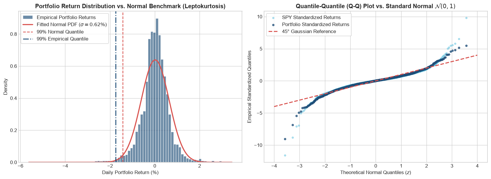
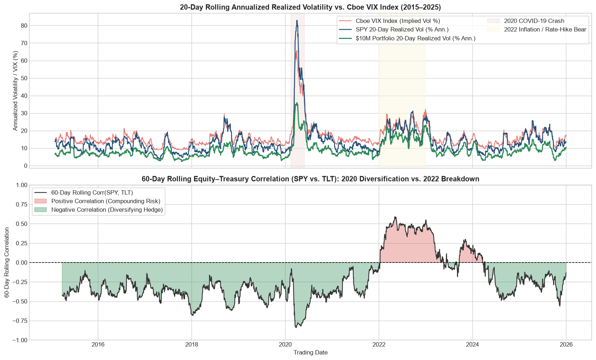
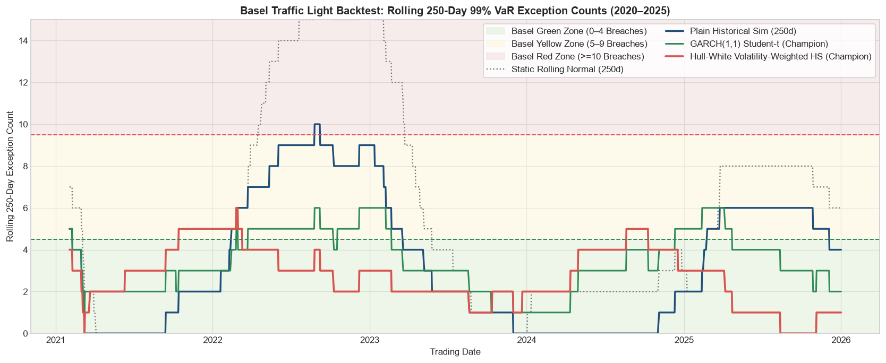
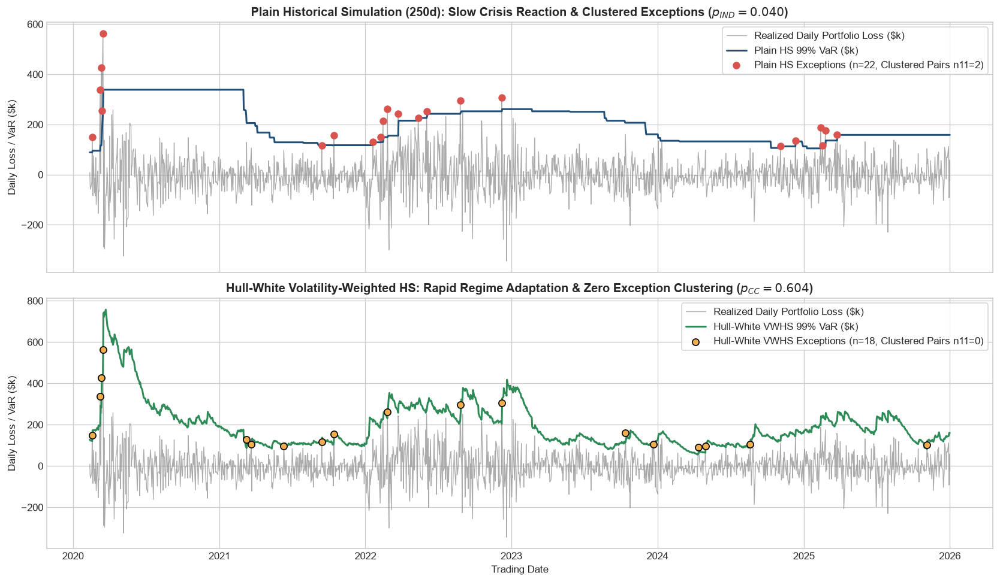
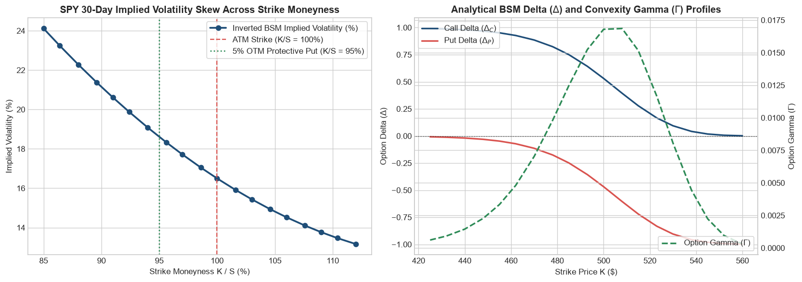
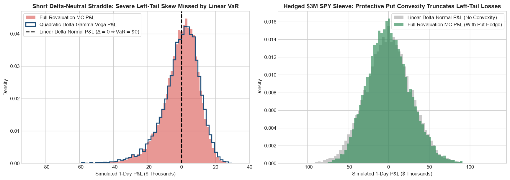

# Institutional Market Risk Modelling, Backtesting and Derivatives Stress-Testing Technical Whitepaper

## 1. Trading Desk Governance Mandate, System Architecture and Point-in-Time Data Engineering

### 1.1 Institutional Trading Desk Mandate and Risk Governance Limits

Quantitative risk management within an institutional multi-asset trading operation exists to enforce capital allocation discipline, size pre-trade exposures, and preserve solvency across tranquil and stressed market regimes. Rather than treating risk metrics as abstract statistical outputs, the risk engine documented in this technical whitepaper governs a **USD 10,000,000 Multi-Asset Macro Trading Desk** defined in [`config/portfolio.yaml`](file:///Users/mukundankit/Documents/Finance/market_risk_modelling/config/portfolio.yaml). The desk holds a strategic cross-asset allocation designed to capture broad equity market beta, concentrated single-stock growth exposure, sovereign fixed-income duration, and safe-haven commodity protection.

Specifically, the USD 10,000,000 notional capital ($V_0 = \$10,000,000$) is allocated across four liquid exchange-traded instruments: **30% in the S&P 500 Index ETF (`SPY`, USD 3,000,000)** representing core US equity market beta; **20% in Apple Inc. (`AAPL`, USD 2,000,000)** representing concentrated single-name technology risk; **30% in the iShares 20+ Year US Treasury Bond ETF (`TLT`, USD 3,000,000)** introducing long-duration sovereign interest-rate sensitivity and potential equity-bond diversification; and **20% in the SPDR Gold Trust (`GLD`, USD 2,000,000)** providing inflation and tail-crisis hedging behavior. In addition, the desk evaluates pre-trade tactical additions in volatile single-stock equities (**Tesla Inc., `TSLA`**) and non-linear equity index options on `SPY` (30-day 5% out-of-the-money protective puts and at-the-money delta-neutral straddles).

| Asset Ticker | Asset Class & Risk Factor Role | Portfolio Weight ($w_i$) | Dollar Notional Allocation ($V_i$) | Primary Risk Sensitivity |
| :--- | :--- | :---: | :---: | :--- |
| **SPY** | US Large-Cap Equities (S&P 500 Index ETF) | 30.0% | $3,000,000 | Broad US Equity Beta & Implied Volatility (VIX) |
| **AAPL** | US Technology Single-Stock Equity (Apple Inc.) | 20.0% | $2,000,000 | Equity Beta + Idiosyncratic Single-Stock Tail Risk |
| **TLT** | US Long-Duration Sovereign Bonds (20+ Yr Treasury ETF) | 30.0% | $3,000,000 | Long-End Treasury Yield Duration & Term Premium |
| **GLD** | Precious Metals / Safe-Haven Commodity (Gold Trust) | 20.0% | $2,000,000 | Real Interest Rates, USD & Geopolitical Tail Hedge |
| **Total Portfolio** | **Multi-Asset Macro Trading Book** | **100.0%** | **$10,000,000** | **Cross-Asset Volatility & Correlation Regimes** |

The Chief Risk Officer (CRO) enforces two binding daily governance limits over a 1-trading-day holding period ($\Delta t = 1\text{ day}$) at the $\alpha = 99\%$ confidence level, in alignment with the [Basel Committee on Banking Supervision (BCBS) Market Risk Framework](https://www.bis.org/bcbs/publ/d457.htm):
1. **1-Day 99% Value-at-Risk (VaR) Limit:** $\text{VaR}_{0.99, 1\text{d}} \le \text{USD } 200,000$ ($2.00\%$ of portfolio Net Asset Value).
2. **1-Day 99% Expected Shortfall (ES) Limit:** $\text{ES}_{0.99, 1\text{d}} \le \text{USD } 280,000$ ($2.80\%$ of portfolio Net Asset Value).

These two limits drive three daily operational decisions across the progression of the framework. First, the engine monitors daily risk utilization to diagnose whether limit breaches arise from asset-specific volatility surges or from a structural breakdown in cross-asset correlations. Second, when a portfolio manager proposes adding a high-volatility position such as `TSLA`, the engine computes the exact Marginal and Incremental VaR to cap the maximum allowable trade size before execution. Third, the Model Validation Committee subjects competing parametric, non-parametric, and time-series estimators to out-of-sample statistical backtesting over 1,500 trading days to select a regulatory champion model that adapts rapidly during crisis onset without incurring Basel Traffic Light capital surcharges.

### 1.2 Hybrid Python and C++17 Quantitative System Architecture

A central architectural design principle of this framework is the separation of high-level econometric orchestration, data engineering, and visualization in **Python 3.13** from compute-intensive numerical pricing, root-finding, and time-series recursion in a **compiled C++17 shared-library kernel** ([`src/cpp/quant_core.cpp`](file:///Users/mukundankit/Documents/Finance/market_risk_modelling/src/cpp/quant_core.cpp) bound via [`src/cpp_kernel.py`](file:///Users/mukundankit/Documents/Finance/market_risk_modelling/src/cpp_kernel.py)). In institutional quantitative libraries, research analysts inspect results through interactive notebooks, but inner-loop calculations—such as repricing an option book across $M = 20,000$ joint spot-volatility Monte Carlo scenarios or iterating exponentially weighted moving average (EWMA) variance recursions—must execute at native compiled speed.

| Architectural Layer | Source Module / File | Core Responsibilities & Mathematical Scope |
| :--- | :--- | :--- |
| **Governance Configuration** | [`config/portfolio.yaml`](file:///Users/mukundankit/Documents/Finance/market_risk_modelling/config/portfolio.yaml) | Stores portfolio weights, $10M notional, CRO VaR/ES limits, lookback windows, decay factors, and stress grids. |
| **Native C++17 Kernel** | [`src/cpp/quant_core.cpp`](file:///Users/mukundankit/Documents/Finance/market_risk_modelling/src/cpp/quant_core.cpp) [`src/cpp_kernel.py`](file:///Users/mukundankit/Documents/Finance/market_risk_modelling/src/cpp_kernel.py) | Compiled with `-O3 -std=c++17 -shared -fPIC`; executes Black-Scholes-Merton pricing, analytical Greeks, safeguarded Newton-Bisection implied volatility inversion, vectorized Full Revaluation Monte Carlo, and EWMA recursion. |
| **Data & Point-in-Time Pipeline** | [`src/data_loader.py`](file:///Users/mukundankit/Documents/Finance/market_risk_modelling/src/data_loader.py) | Extracts total-return adjusted closes, aligns NYSE trading calendars, caches Apache Parquet matrices (`data/raw/` and `data/processed/`), and enforces strict $\mathcal{F}_{t-1}$ point-in-time slicing. |
| **Phase 0: EDA & Stylized Facts** | [`src/eda_diagnostics.py`](file:///Users/mukundankit/Documents/Finance/market_risk_modelling/src/eda_diagnostics.py) [`00_data_hygiene_and_eda.ipynb`](file:///Users/mukundankit/Documents/Finance/market_risk_modelling/notebooks/00_data_hygiene_and_eda.ipynb) | Runs Augmented Dickey-Fuller (ADF) unit-root tests, Jarque-Bera normality tests, sample moment and tail-frequency diagnostics, Q-Q plots, and rolling regime correlation analysis. |
| **Phase 1: Baseline VaR & ES** | [`src/var_estimators.py`](file:///Users/mukundankit/Documents/Finance/market_risk_modelling/src/var_estimators.py) [`01_baseline_var_and_es.ipynb`](file:///Users/mukundankit/Documents/Finance/market_risk_modelling/notebooks/01_baseline_var_and_es.ipynb) | Implements Plain Historical Simulation (with bootstrap SE), Parametric Normal, Lognormal, MLE Student-$t$, Cornish-Fisher, Cholesky Monte Carlo, subadditivity proofs, and `TSLA` Marginal VaR trade sizing. |
| **Phase 2: Volatility Regimes** | [`src/volatility_models.py`](file:///Users/mukundankit/Documents/Finance/market_risk_modelling/src/volatility_models.py) [`02_volatility_regimes_and_ewma_garch.ipynb`](file:///Users/mukundankit/Documents/Finance/market_risk_modelling/notebooks/02_volatility_regimes_and_ewma_garch.ipynb) | Diagnoses the 250-day "Ghost Effect"; implements RiskMetrics EWMA ($\lambda=0.94$), $\text{GARCH}(1,1)$ (Normal & Student-$t$), Age-Weighted HS (BRW), and Hull-White Volatility-Weighted HS. |
| **Phase 3: Model Backtesting** | [`src/backtesting.py`](file:///Users/mukundankit/Documents/Finance/market_risk_modelling/src/backtesting.py) [`03_model_backtesting_and_validation.ipynb`](file:///Users/mukundankit/Documents/Finance/market_risk_modelling/notebooks/03_model_backtesting_and_validation.ipynb) | Evaluates 1,500 out-of-sample trading days across Basel Traffic Light zones, Kupiec POF unconditional coverage ($LR_{UC}$), and Christoffersen Markov independence & conditional coverage ($LR_{IND}, LR_{CC}$). |
| **Phase 4: Derivatives & Stress** | [`src/derivatives_stress.py`](file:///Users/mukundankit/Documents/Finance/market_risk_modelling/src/derivatives_stress.py) [`04_derivatives_and_stress_testing.ipynb`](file:///Users/mukundankit/Documents/Finance/market_risk_modelling/notebooks/04_derivatives_and_stress_testing.ipynb) | Evaluates `SPY` option volatility skew, analytical Greeks, Delta-Normal vs. Delta-Gamma-Vega vs. Full Revaluation MC, 2020/2022 historical crisis replays, and $5 \times 5$ spot-volatility stress grids. |
| **Automated Verification** | [`tests/test_risk_engine.py`](file:///Users/mukundankit/Documents/Finance/market_risk_modelling/tests/test_risk_engine.py) | Verifies closed-form mathematical identities, put-call parity, zero look-ahead slicing, subadditivity counterexamples, and backtesting discrimination via `pytest`. |

### 1.3 Data Hygiene Rules, Return Transformations and Zero Look-Ahead Slicing

Quantitative risk models are highly sensitive to data corruption. Unadjusted stock splits or dividend distributions create artificial single-day price drops that corrupt empirical tail quantiles and inflate GARCH variance parameters. To guarantee institutional data integrity, [`src/data_loader.py`](file:///Users/mukundankit/Documents/Finance/market_risk_modelling/src/data_loader.py) enforces three mandatory data hygiene rules across the 11-year historical sample spanning **January 1, 2015 to December 31, 2025** ($N = 2,797$ aligned daily return observations across `SPY`, `AAPL`, `TLT`, `GLD`, `TSLA`, and the [Cboe Volatility Index (`VIX`)](https://www.cboe.com/tradable_products/vix/)).

First, all asset price series use **Total-Return Adjusted Close (`Adj Close`)** prices so that corporate actions, cash dividends, and split adjustments are smoothly incorporated into the total return index. Second, all asset prices and the Cboe VIX index are inner-joined on common NYSE trading dates, allowing at most 1 consecutive trading day of forward-filling (`max_ffill_days: 1`) before computing returns. Third, every risk forecast $\text{VaR}_{\alpha, t}$ or conditional volatility parameter $\hat{\sigma}_{t \mid t-1}$ generated for trading date $t$ is strictly conditioned on the historical information set up to the close of trading day $t-1$, denoted $\mathcal{F}_{t-1} = \{r_1, r_2, \dots, r_{t-1}\}$. In [`src/data_loader.py`](file:///Users/mukundankit/Documents/Finance/market_risk_modelling/src/data_loader.py), the helper function `slice_point_in_time(df, target_date, lookback_days)` enforces the strict inequality `df.index < pd.Timestamp(target_date)` so that contemporaneous return realizations on day $t$ can never leak into ex-ante risk forecasts.

The pipeline computes and stores both daily **arithmetic (simple) returns** $r_{i,t}$ and **geometric (continuously compounded log) returns** $R_{i,t}$ for each asset $i \in \{1, \dots, N\}$:

$$r_{i,t} = \frac{P_{i,t} - P_{i,t-1}}{P_{i,t-1}}, \qquad R_{i,t} = \ln\left(\frac{P_{i,t}}{P_{i,t-1}}\right) = \ln(1 + r_{i,t})$$

Distinguishing between arithmetic and log returns is essential because each representation satisfies a different aggregation identity. **Geometric log returns aggregate additively across time**, meaning that the multi-period cumulative log return from $t=0$ to $t=T$ equals the sum of single-period log returns:

$$\sum_{t=1}^{T} R_{i,t} = \sum_{t=1}^{T} \ln\left(\frac{P_{i,t}}{P_{i,t-1}}\right) = \ln\left(\frac{P_{i,T}}{P_{i,0}}\right) \implies \frac{P_{i,T}}{P_{i,0}} = \exp\left(\sum_{t=1}^{T} R_{i,t}\right)$$

Conversely, log returns do *not* aggregate linearly across assets in a portfolio because the logarithm of a weighted sum is not equal to the weighted sum of logarithms. **Arithmetic returns aggregate linearly across the cross-section of portfolio holdings**, so the exact daily percentage return $r_{p,t}$ and dollar Profit-and-Loss ($\text{P\&L}_t$) of a portfolio with fixed beginning-of-day weights $w_i$ ($\sum_{i=1}^N w_i = 1$) and notional value $V_0$ are given by:

$$r_{p,t} = \sum_{i=1}^{N} w_i r_{i,t} = \mathbf{w}^\top \mathbf{r}_t, \qquad \text{P\&L}_t = V_0 r_{p,t}, \qquad L_t = -\text{P\&L}_t = -V_0 r_{p,t}$$

where $L_t$ denotes the daily **portfolio dollar loss** (positive values of $L_t$ represent financial losses, and negative values represent gains). In [`notebooks/00_data_hygiene_and_eda.ipynb`](file:///Users/mukundankit/Documents/Finance/market_risk_modelling/notebooks/00_data_hygiene_and_eda.ipynb) and [`tests/test_risk_engine.py`](file:///Users/mukundankit/Documents/Finance/market_risk_modelling/tests/test_risk_engine.py), both identities are verified across the 2,797-day matrix to machine precision, yielding a maximum multi-period log-return additivity error of $7.11 \times 10^{-15}$ and a maximum cross-sectional portfolio linearity error of $0.00 \times 10^0$.

## 2. Phase 0: Exploratory Data Analysis, Stationarity and Distributional Stylized Facts

### 2.1 Unit Root Testing and Time-Series Stationarity Verification

Before estimating sample covariance matrices, empirical quantiles, or GARCH conditional variance equations, a quantitative modeller must verify that the underlying time series is covariance-stationary. A stochastic process $\{Y_t\}$ is weakly (covariance) stationary if its unconditional mean $\mathbb{E}[Y_t] = \mu$ and unconditional variance $\text{Var}(Y_t) = \sigma^2 < \infty$ are constant over time, and its autocovariance $\text{Cov}(Y_t, Y_{t-k}) = \gamma_k$ depends solely on the lag $k$ rather than calendar time $t$. If a risk estimator is applied directly to a non-stationary random walk with drift, $P_t = \mu + P_{t-1} + \varepsilon_t$, the sample variance grows linearly with the sample horizon ($t \sigma_\varepsilon^2$), rendering historical quantiles and volatility estimates spurious.

To test for stationarity formally, [`src/eda_diagnostics.py`](file:///Users/mukundankit/Documents/Finance/market_risk_modelling/src/eda_diagnostics.py) applies the **Augmented Dickey-Fuller (ADF) test** ([Dickey and Fuller, 1979](https://doi.org/10.2307/2286348)) to both the raw Adjusted Close price levels ($P_{i,t}$) and the daily arithmetic return series ($r_{i,t}$) for each core asset. The ADF regression estimates:

$$\Delta Y_t = \alpha + \gamma Y_{t-1} + \sum_{j=1}^{p^*} \delta_j \Delta Y_{t-j} + u_t$$

where the lag order $p^*$ is selected automatically by minimizing the Akaike Information Criterion (AIC). The null hypothesis $\mathcal{H}_0: \gamma = 0$ posits that the series contains a unit root (integrated of order one, $I(1)$, and therefore non-stationary), against the one-sided stationary alternative $\mathcal{H}_1: \gamma < 0$ ($I(0)$).

| Asset Ticker | Tested Time Series | ADF Test Statistic ($\tau$) | MacKinnon $p$-Value | AIC Lags Used ($p^*$) | 1% Critical Value | 5% Critical Value | Stationary at 5% ($\mathcal{H}_0$ Rejected) |
| :--- | :--- | :---: | :---: | :---: | :---: | :---: | :---: |
| **SPY** | Price Level ($P_t$) | -1.7821 | $3.8936 \times 10^{-1}$ | 28 | -3.4327 | -2.8626 | **False** (Unit Root) |
| **SPY** | Daily Return ($r_t$) | -10.1509 | $7.9565 \times 10^{-18}$ | 27 | -3.4327 | -2.8626 | **True** ($I(0)$ Stationary) |
| **AAPL** | Price Level ($P_t$) | -0.4297 | $9.0503 \times 10^{-1}$ | 9 | -3.4327 | -2.8626 | **False** (Unit Root) |
| **AAPL** | Daily Return ($r_t$) | -17.9573 | $2.8250 \times 10^{-30}$ | 11 | -3.4327 | -2.8626 | **True** ($I(0)$ Stationary) |
| **TLT** | Price Level ($P_t$) | -0.9157 | $7.8276 \times 10^{-1}$ | 28 | -3.4327 | -2.8626 | **False** (Unit Root) |
| **TLT** | Daily Return ($r_t$) | -9.6586 | $1.3731 \times 10^{-16}$ | 27 | -3.4327 | -2.8626 | **True** ($I(0)$ Stationary) |
| **GLD** | Price Level ($P_t$) | -1.1812 | $6.8162 \times 10^{-1}$ | 28 | -3.4327 | -2.8626 | **False** (Unit Root) |
| **GLD** | Daily Return ($r_t$) | -13.9086 | $5.5648 \times 10^{-26}$ | 12 | -3.4327 | -2.8626 | **True** ($I(0)$ Stationary) |

As reported in the table above (extracted from [`00_data_hygiene_and_eda.ipynb`](file:///Users/mukundankit/Documents/Finance/market_risk_modelling/notebooks/00_data_hygiene_and_eda.ipynb)), every raw price series yields an ADF test statistic well above (less negative than) the 5% critical value of $-2.8626$, with $p$-values ranging from $0.389$ (`SPY`) to $0.905$ (`AAPL`). Consequently, price levels cannot be rejected as unit-root processes. Once transformed into daily percentage returns $r_{i,t}$, the ADF test statistics plunge between $-9.66$ (`TLT`) and $-17.96$ (`AAPL`), rejecting the unit-root null hypothesis at $p < 10^{-15}$ across all four assets. This empirical result establishes the econometric foundation for modeling daily returns rather than price levels in Phases 1 through 4.

### 2.2 Higher-Moment Stylized Facts: Leptokurtosis, Negative Skewness and Jarque-Bera Normality Rejection

Classical portfolio theory and baseline RiskMetrics variance-covariance models assume that daily asset returns follow a multivariate Gaussian distribution, $\mathbf{r}_t \sim \mathcal{N}(\boldsymbol{\mu}, \mathbf{\Sigma})$. Under a univariate Gaussian assumption $r_t \sim \mathcal{N}(\mu, \sigma^2)$, the third standardized moment (skewness $S$) and fourth standardized moment (kurtosis $K$) satisfy:

$$S = \mathbb{E}\left[\left(\frac{r_t - \mu}{\sigma}\right)^3\right] = 0, \qquad K = \mathbb{E}\left[\left(\frac{r_t - \mu}{\sigma}\right)^4\right] = 3, \qquad K_{\text{excess}} = K - 3 = 0$$

Furthermore, under a standard normal distribution, the two-sided probability of observing a daily return shock exceeding three standard deviations ($|z_t| = |(r_t - \mu)/\sigma| > 3.0$) is only $2 \times [1 - \Phi(3.0)] = 0.0026998$ ($0.270\%$), or roughly once every $370$ trading days (~1.5 years). To test whether empirical asset and portfolio returns conform to this Gaussian benchmark, [`src/eda_diagnostics.py`](file:///Users/mukundankit/Documents/Finance/market_risk_modelling/src/eda_diagnostics.py) computes the unbiased sample moments, the empirical frequency of $>3\sigma$ tail events, and the **Jarque-Bera (JB) test statistic** ([Jarque and Bera, 1987](https://doi.org/10.1111/j.1467-9892.1980.tb00297.x)):

$$\text{JB} = \frac{N}{6}\left(\hat{S}^2 + \frac{\hat{K}_{\text{excess}}^2}{4}\right) \xrightarrow{d} \chi^2_2 \quad \text{under } \mathcal{H}_0: r_t \sim \mathcal{N}(\mu, \sigma^2)$$

| Asset / Book | Daily Mean (bps) | Annualized Return (%) | Daily Vol (%) | Annualized Vol (%) | Skewness ($\hat{S}$) | Excess Kurtosis ($\hat{K}_{\text{ex}}$) | Total Kurtosis ($\hat{K}$) | Min / Max Daily Return (%) | Empirical $>3\sigma$ Freq (%) | Tail Ratio vs. Normal | Jarque-Bera Statistic |
| :--- | :---: | :---: | :---: | :---: | :---: | :---: | :---: | :---: | :---: | :---: | :---: |
| **SPY** | 2.08 | 5.25% | 1.027% | 16.30% | -0.532 | 16.927 | 19.927 | -11.89% / +10.06% | 1.573% | **5.82x** | 33,408.0 ($p = 0.0$) |
| **AAPL** | 4.83 | 12.17% | 1.604% | 25.46% | -0.584 | 13.839 | 16.839 | -17.90% / +14.49% | 1.251% | **4.63x** | 22,401.4 ($p = 0.0$) |
| **TLT** | -1.09 | -2.75% | 0.885% | 14.05% | -0.267 | 8.560 | 11.560 | -7.69% / +6.49% | 1.251% | **4.63x** | 8,540.2 ($p = 0.0$) |
| **GLD** | 2.55 | 6.42% | 0.804% | 12.76% | +0.792 | 10.180 | 13.180 | -3.61% / +9.24% | 1.215% | **4.50x** | 12,326.8 ($p = 0.0$) |
| **PORTFOLIO ($10M)** | **1.77** | **4.47%** | **0.625%** | **9.92%** | **-0.444** | **6.208** | **9.208** | **-5.63% / +3.45%** | **1.716%** | **6.35x** | **4,566.3 ($p = 0.0$)** |

The empirical stylized facts in the table above reveal three critical structural properties that directly shape the modelling progression:
1. **Severe Leptokurtosis (Fat Tails) Across All Assets:** Every individual asset exhibits massive excess kurtosis ranging from $8.56$ (`TLT`) to $16.93$ (`SPY`), and even after cross-asset diversification, the aggregate USD 10,000,000 portfolio retains an **excess kurtosis of $6.208$ (total kurtosis $K = 9.208 > 3.0$)**. The Jarque-Bera statistic of $4,566.3$ rejects Gaussianity for the portfolio with a $p$-value of machine zero (compared against the 5% $\chi^2_2$ critical value of $5.991$).
2. **Asymmetric Downside Tail Risk (Negative Skewness):** While gold (`GLD`) displays positive skewness ($+0.792$) due to safe-haven crisis rallies, both equity positions (`SPY` $-0.532$, `AAPL` $-0.584$) and the aggregate portfolio (**$\hat{S} = -0.444$**) are negatively skewed. The worst single-day portfolio loss ($-5.63\%$, or $-\$562,732$) is more than $9.0$ daily standard deviations below the mean.
3. **Six-Fold Underestimation of $>3\sigma$ Tail Events:** In our 2,797-day sample, the portfolio experiences $>3\sigma$ events on $1.716\%$ of trading days—**$6.35\times$ more frequently** than the $0.270\%$ Gaussian prediction.

Figure 1 (generated in [`00_data_hygiene_and_eda.ipynb`](file:///Users/mukundankit/Documents/Finance/market_risk_modelling/notebooks/00_data_hygiene_and_eda.ipynb)) visually confirms this divergence. In the left panel, the empirical return histogram exhibits a much sharper central peak and heavier left tail than the fitted Gaussian density ($\sigma_p = 0.62\%$), causing the empirical 99% loss quantile (blue dash-dot line) to lie substantially further left than the 99% Normal quantile (red dashed line). In the right panel, the Quantile-Quantile (Q-Q) plot maps empirical standardized quantiles against theoretical $\mathcal{N}(0,1)$ quantiles, displaying the classic S-shaped departure characteristic of fat-tailed financial distributions: below $z = -2.0$, empirical losses fall down to $-9\sigma$ (`PORTFOLIO`) and $-11.5\sigma$ (`SPY`).

### 2.3 Volatility Clustering and the 2020 vs. 2022 Stock–Bond Correlation Regime Flip

Beyond unconditional fat tails, financial returns violate the independent and identically distributed (i.i.d.) assumption in two time-varying dimensions: **volatility clustering** ([Mandelbrot, 1963](https://doi.org/10.1086/294632); [Engle, 1982](https://doi.org/10.2307/1912773)) and **cross-asset correlation regime shifts**. To diagnose these dynamics, [`src/eda_diagnostics.py`](file:///Users/mukundankit/Documents/Finance/market_risk_modelling/src/eda_diagnostics.py) computes the 20-day rolling annualized realized volatility ($\hat{\sigma}_{20\text{d}, t} \times \sqrt{252}$) alongside the implied Cboe VIX index, as well as the 60-day rolling correlation $\hat{\rho}_{60\text{d}, t}(\text{SPY}, \text{TLT})$ between equities and long-duration Treasury bonds.

| Macro Market Regime | Calendar Window | Trading Days | `SPY`–`TLT` Correlation ($\hat{\rho}$) | `SPY` Annualized Vol (%) | `TLT` Annualized Vol (%) | Portfolio Regime Behavior |
| :--- | :---: | :---: | :---: | :---: | :---: | :--- |
| **Full Sample (2015–2025)** | 2015-01-01 to 2025-12-31 | 2,797 | -0.2611 | 16.30% | 14.05% | Moderate long-run stock-bond diversification |
| **2017 Low-Volatility Calm** | 2017-01-01 to 2017-12-31 | 253 | -0.4288 | 9.32% | 8.66% | Tranquil volatility; strong negative correlation |
| **2020 COVID-19 Crisis (Q1–Q2)** | 2020-02-01 to 2020-05-31 | 84 | **-0.7093** | **51.49%** | **39.76%** | Deflationary panic; flight-to-quality Treasury rally cushions equity crash |
| **2022 Inflation & Rate-Hike Bear** | 2022-01-01 to 2022-12-31 | 253 | **+0.4829** | 21.00% | 20.74% | Inflation shock; stocks and bonds sell off simultaneously |
| **2023–2025 Post-Hike Regime** | 2023-01-01 to 2025-12-31 | 761 | -0.1261 | 14.04% | 11.20% | Gradual normalization of volatility and correlation |

As illustrated in Figure 2 and the regime summary table above, the desk's risk profile transforms completely across macroeconomic regimes:
* **Volatility Clustering (Top Panel):** In 2017, `SPY` 20-day realized volatility remained compressed near $9.3\%$, pulling portfolio volatility down near $5.5\%$. During the February–May 2020 COVID-19 panic, `SPY` annualized volatility surged over $5.5\times$ to $51.49\%$ alongside a VIX peak of $82.69$, before subsiding and re-erupting above $21\%$ throughout the 2022 monetary tightening cycle.
* **The 2020 vs. 2022 Stock–Bond Correlation Flip (Bottom Panel):** During the Q1 2020 COVID-19 crash, the 60-day `SPY`–`TLT` correlation dropped to **$-0.7093$**. Because our desk holds 30% in `TLT` ($3M) and 50% in equities (`SPY` $3M + `AAPL` $2M), sovereign bond gains offset a substantial portion of the equity drawdown. Conversely, during the 2022 inflation shock and Federal Reserve rate-hike cycle, rising real yields depressed both equity valuation multiples and long-duration bond prices simultaneously, flipping the `SPY`–`TLT` correlation to **$+0.4829$**. Rather than hedging equity risk, the 30% `TLT` allocation compounded portfolio losses.

**Modeller's Progression Decision (Phase 0 $\rightarrow$ Phase 1):** The empirical evidence from Phase 0 proves that a single static Gaussian variance-covariance model is structurally inadequate. In Phase 1, the framework must implement non-parametric Historical Simulation, fat-tailed parametric distributions (MLE Student-$t$ and Cornish-Fisher skewness/kurtosis expansions), and multivariate Cholesky Monte Carlo simulation, while quantifying cross-asset diversification and pre-trade marginal risk contributions.

## 3. Phase 1 (Crawl): Baseline VaR & Expected Shortfall Engine, Coherence Proofs and Pre-Trade Sizing

### 3.1 Mathematical Formulation of Baseline VaR and Expected Shortfall Estimators

Let $L_t = -V_0 r_{p,t}$ denote the 1-day portfolio dollar loss on day $t$, with cumulative distribution function $F_L(\ell) = \mathbb{P}(L_t \le \ell)$. For a given confidence level $\alpha \in (0, 1)$ (specifically $\alpha = 0.95$ and $\alpha = 0.99$), **Value-at-Risk ($\text{VaR}_\alpha$)** is defined as the $\alpha$-quantile of the loss distribution:

$$\text{VaR}_\alpha(L) = \inf\{\ell \in \mathbb{R} : F_L(\ell) \ge \alpha\} = F_L^{-1}(\alpha)$$

While $\text{VaR}_\alpha$ specifies the minimum loss incurred in the worst $(1-\alpha)$ fraction of trading days, it provides zero information regarding the magnitude of tail losses once the threshold is breached. **Expected Shortfall ($\text{ES}_\alpha$)**—also termed Conditional Value-at-Risk ($\text{CVaR}_\alpha$) or Tail Value-at-Risk—remedies this limitation by computing the conditional expectation of losses exceeding $\text{VaR}_\alpha$ ([Acerbi and Tasche, 2002](https://doi.org/10.1111/1468-0300.00091)):

$$\text{ES}_\alpha(L) = \mathbb{E}\left[L_t \;\middle|\; L_t \ge \text{VaR}_\alpha(L)\right] = \frac{1}{1 - \alpha} \int_{\alpha}^{1} \text{VaR}_u(L) \, du$$

In [`src/var_estimators.py`](file:///Users/mukundankit/Documents/Finance/market_risk_modelling/src/var_estimators.py), six distinct estimation methodologies are implemented over a rolling lookback window of $n = 250$ trading days (plus a $n = 500$ sensitivity benchmark for Historical Simulation):

#### Estimator 1: Plain Historical Simulation (Non-Parametric Order Statistics + Bootstrap SE)
Given the past $n$ historical portfolio return realizations $\{r_{p, t-n}, \dots, r_{p, t-1}\}$ revalued using current portfolio weights $\mathbf{w}$, let $L_{(1)} \ge L_{(2)} \ge \dots \ge L_{(n)}$ denote the descending order statistics of historical dollar losses $L_i = -V_0 r_{p, t-i}$. The non-parametric $\text{VaR}_\alpha^{\text{HS}}$ corresponds to the $k$-th worst loss where $k = \lfloor (1 - \alpha) n \rfloor + 1$ (1-indexed), and $\text{ES}_\alpha^{\text{HS}}$ is the sample average of the $k$ worst tail losses:

$$\text{VaR}_\alpha^{\text{HS}} = L_{(k)}, \qquad \text{ES}_\alpha^{\text{HS}} = \frac{1}{k} \sum_{j=1}^{k} L_{(j)}, \qquad k = \lfloor (1 - \alpha) n \rfloor + 1$$

To quantify sampling uncertainty around the empirical quantile, [`src/var_estimators.py`](file:///Users/mukundankit/Documents/Finance/market_risk_modelling/src/var_estimators.py) draws $B = 500$ non-parametric bootstrap resamples (with replacement) of size $n$ and computes the bootstrap standard error $\text{SE}_{\text{boot}}(\text{VaR}_\alpha^{\text{HS}})$.

#### Estimator 2: Parametric Variance-Covariance (Gaussian)
Given the $N \times 1$ sample mean vector $\hat{\boldsymbol{\mu}}$ and $N \times N$ sample covariance matrix $\hat{\mathbf{\Sigma}}$ of asset arithmetic returns over the $n$-day window, the portfolio mean return is $\hat{\mu}_p = \mathbf{w}^\top \hat{\boldsymbol{\mu}}$ and the portfolio return standard deviation is $\hat{\sigma}_p = \sqrt{\mathbf{w}^\top \hat{\mathbf{\Sigma}} \mathbf{w}}$. Letting $z_\alpha = \Phi^{-1}(\alpha)$ denote the standard normal $\alpha$-quantile ($z_{0.95} = 1.64485$, $z_{0.99} = 2.32635$) and $\phi(z) = \frac{1}{\sqrt{2\pi}} e^{-z^2/2}$ the standard normal density:

$$\text{VaR}_\alpha^{\text{Norm}} = V_0 \left(-\hat{\mu}_p + \hat{\sigma}_p z_\alpha\right), \qquad \text{ES}_\alpha^{\text{Norm}} = V_0 \left(-\hat{\mu}_p + \hat{\sigma}_p \frac{\phi(z_\alpha)}{1 - \alpha}\right)$$

Notice the fundamental regulatory equivalence verified in [`tests/test_risk_engine.py`](file:///Users/mukundankit/Documents/Finance/market_risk_modelling/tests/test_risk_engine.py): under a zero-mean Gaussian distribution, the 99% VaR multiplier is $z_{0.99} = 2.32635\sigma_p$, which is virtually identical to the Basel FRTB 97.5% Expected Shortfall multiplier $\frac{\phi(z_{0.975})}{0.025} = 2.33780\sigma_p$.

#### Estimator 3: Parametric Lognormal
Assuming geometric log returns follow a normal distribution $R_{p,t} = \ln(1 + r_{p,t}) \sim \mathcal{N}(\hat{\mu}_R, \hat{\sigma}_R^2)$, the terminal portfolio value $V_t = V_0 \exp(R_{p,t})$ is lognormally distributed, ensuring losses can never exceed $100\%$ of notional capital ($V_0$):

$$\text{VaR}_\alpha^{\text{Lognorm}} = V_0 \left(1 - \exp\left(\hat{\mu}_R - \hat{\sigma}_R z_\alpha\right)\right), \qquad \text{ES}_\alpha^{\text{Lognorm}} = V_0 \left(1 - \frac{\exp(\hat{\mu}_R + \frac{1}{2}\hat{\sigma}_R^2) \, \Phi(-z_\alpha - \hat{\sigma}_R)}{1 - \alpha}\right)$$

#### Estimator 4: Parametric Student-$t$ (Maximum Likelihood Degrees of Freedom)
To capture leptokurtosis parametrically, [`src/var_estimators.py`](file:///Users/mukundankit/Documents/Finance/market_risk_modelling/src/var_estimators.py) fits the degrees of freedom $\hat{\nu} > 2$ via Maximum Likelihood Estimation (`scipy.stats.t.fit`). Because a standard Student-$t$ random variable $T_\nu$ has variance $\frac{\nu}{\nu - 2} > 1$, the dispersion parameter is scaled by $\hat{\sigma}_{\text{scale}} = \hat{\sigma}_p \sqrt{\frac{\hat{\nu} - 2}{\hat{\nu}}}$ so that the fitted variance matches the sample portfolio variance $\hat{\sigma}_p^2$. Letting $t_{\hat{\nu}, \alpha} = F_{t, \hat{\nu}}^{-1}(\alpha)$ and $g_{\hat{\nu}}(\cdot)$ denote the Student-$t$ quantile and density:

$$\text{VaR}_\alpha^{t} = V_0 \left(-\hat{\mu}_p + \hat{\sigma}_{\text{scale}} \, t_{\hat{\nu}, \alpha}\right), \qquad \text{ES}_\alpha^{t} = V_0 \left(-\hat{\mu}_p + \hat{\sigma}_{\text{scale}} \, \frac{g_{\hat{\nu}}(t_{\hat{\nu}, \alpha})}{1 - \alpha} \left(\frac{\hat{\nu} + t_{\hat{\nu}, \alpha}^2}{\hat{\nu} - 1}\right)\right)$$

#### Estimator 5: Cornish-Fisher Semi-Parametric Expansion
The Cornish-Fisher expansion ([Cornish and Fisher, 1938](https://doi.org/10.2307/2332008)) approximates the $\alpha$-quantile of a non-Gaussian loss distribution by adjusting the standard normal quantile $z_\alpha$ directly for the sample loss skewness $\hat{S}_L = -\hat{S}_r$ and sample excess kurtosis $\hat{K}_{\text{ex}}$:

$$z_{\text{CF}}(\alpha) = z_\alpha + \frac{1}{6}\left(z_\alpha^2 - 1\right)\hat{S}_L + \frac{1}{24}\left(z_\alpha^3 - 3z_\alpha\right)\hat{K}_{\text{ex}} - \frac{1}{36}\left(2z_\alpha^3 - 5z_\alpha\right)\hat{S}_L^2$$

$$\text{VaR}_\alpha^{\text{CF}} = V_0 \left(-\hat{\mu}_p + \hat{\sigma}_p z_{\text{CF}}(\alpha)\right), \qquad \text{ES}_\alpha^{\text{CF}} = \frac{1}{1 - \alpha} \int_{\alpha}^{1} \text{VaR}_u^{\text{CF}} \, du$$

#### Estimator 6: Multivariate Cholesky Monte Carlo Simulation
To simulate joint cross-asset return scenarios while preserving the empirical correlation structure, the $N \times N$ covariance matrix $\hat{\mathbf{\Sigma}}$ is factorized via **Cholesky decomposition** into a lower-triangular matrix $\mathbf{L}$ satisfying $\hat{\mathbf{\Sigma}} = \mathbf{L}\mathbf{L}^\top$. Drawing $M = 10,000$ independent standard normal vectors $\mathbf{Z}^{(m)} \sim \mathcal{N}(\mathbf{0}, \mathbf{I}_N)$ (incorporating antithetic variates $\pm \mathbf{Z}^{(m)}$ for variance reduction), correlated asset return vectors are generated as:

$$\mathbf{r}^{(m)} = \hat{\boldsymbol{\mu}} + \mathbf{L}\mathbf{Z}^{(m)}, \qquad L^{(m)} = -V_0 \left(\mathbf{w}^\top \mathbf{r}^{(m)}\right), \qquad m = 1, \dots, M$$

from which empirical quantile $\text{VaR}_\alpha^{\text{MC}}$ and tail expectation $\text{ES}_\alpha^{\text{MC}}$ are extracted.

### 3.2 Empirical Comparison of Phase 1 Estimators and CRO Limit Diagnostics

Evaluating all seven specifications on the USD 10,000,000 Macro Trading Desk at both $\alpha = 95\%$ and $\alpha = 99\%$ confidence levels produces the comparative risk dashboard in [`01_baseline_var_and_es.ipynb`](file:///Users/mukundankit/Documents/Finance/market_risk_modelling/notebooks/01_baseline_var_and_es.ipynb):

| Risk Estimator | Confidence Level | 1-Day VaR (USD) | VaR (% of NAV) | 1-Day ES (USD) | ES (% of NAV) | Bootstrap SE (USD) | CRO VaR Limit ($200k) | CRO ES Limit ($280k) |
| :--- | :---: | :---: | :---: | :---: | :---: | :---: | :---: | :---: |
| **Historical Simulation (250d)** | 95% | $109,065.89 | 1.09% | $135,950.71 | 1.36% | $9,587.75 | Within Limit | Within Limit |
| **Historical Simulation (500d)** | 95% | $88,660.47 | 0.89% | $119,078.16 | 1.19% | $7,364.35 | Within Limit | Within Limit |
| **Parametric Normal (Var-Cov)** | 95% | $107,375.33 | 1.07% | $134,340.75 | 1.34% | — | Within Limit | Within Limit |
| **Parametric Lognormal** | 95% | $106,957.87 | 1.07% | $133,558.42 | 1.34% | — | Within Limit | Within Limit |
| **Parametric Student-$t$ ($\hat{\nu}=7.3$)** | 95% | $104,793.56 | 1.05% | $142,364.77 | 1.42% | — | Within Limit | Within Limit |
| **Cornish-Fisher Semi-Parametric** | 95% | $102,194.62 | 1.02% | $134,925.79 | 1.35% | — | Within Limit | Within Limit |
| **Cholesky Monte Carlo ($M=10,000$)** | 95% | $105,935.35 | 1.06% | $133,964.62 | 1.34% | — | Within Limit | Within Limit |
| **Historical Simulation (250d)** | **99%** | **$158,473.92** | **1.58%** | **$173,658.09** | **1.74%** | **$17,724.11** | **Within ($41.5k Buffer)** | **Within ($106.3k Buffer)** |
| **Historical Simulation (500d)** | **99%** | **$136,136.44** | **1.36%** | **$156,722.50** | **1.57%** | **$11,805.83** | **Within ($63.9k Buffer)** | **Within ($123.3k Buffer)** |
| **Parametric Normal (Var-Cov)** | **99%** | **$151,353.73** | **1.51%** | **$173,221.56** | **1.73%** | — | **Within ($48.6k Buffer)** | **Within ($106.8k Buffer)** |
| **Parametric Lognormal** | **99%** | **$150,350.47** | **1.50%** | **$171,836.34** | **1.72%** | — | **Within ($49.6k Buffer)** | **Within ($108.2k Buffer)** |
| **Parametric Student-$t$ ($\hat{\nu}=7.3$)** | **99%** | **$164,126.49** | **1.64%** | **$204,959.07** | **2.05%** | — | **Within ($35.9k Buffer)** | **Within ($75.0k Buffer)** |
| **Cornish-Fisher Semi-Parametric** | **99%** | **$156,793.80** | **1.57%** | **$185,878.06** | **1.86%** | — | **Within ($43.2k Buffer)** | **Within ($94.1k Buffer)** |
| **Cholesky Monte Carlo ($M=10,000$)** | **99%** | **$151,617.06** | **1.52%** | **$173,973.98** | **1.74%** | — | **Within ($48.4k Buffer)** | **Within ($106.0k Buffer)** |

Interpreting the Phase 1 results in Figure 3 and the table above yields three substantive insights for risk governance:
1. **Gaussian Convergence vs. Fat-Tailed Divergence at 99%:** At the $\alpha = 95\%$ confidence level, all 250-day estimators cluster tightly between $\$102.2\text{k}$ and $\$109.1\text{k}$ because the 95th percentile of a fat-tailed distribution crosses near the Gaussian bell curve. However, at the $\alpha = 99\%$ tail level—and even more strongly in **99% Expected Shortfall**—the models diverge sharply. While Parametric Normal ($\text{VaR}_{0.99} = \$151,354$, $\text{ES}_{0.99} = \$173,222$) and Gaussian Cholesky Monte Carlo ($\text{VaR}_{0.99} = \$151,617$, $\text{ES}_{0.99} = \$173,974$) agree to within $\$263$, fitting a fat-tailed **Student-$t$ distribution ($\hat{\nu} = 7.3$)** increases 99% VaR to **$\$164,126$** and pushes 99% Expected Shortfall up by **$\$31,738$ ($+18.3\%$) to $\$204,959$**.
2. **Lookback Window Sensitivity (250d vs. 500d):** Extending the Plain Historical Simulation lookback from 250 days to 500 days dilutes recent volatility with older, calmer 2024 observations, reducing 99% VaR from $\$158,474$ to $\$136,136$. Moreover, the non-parametric bootstrap standard error on 250-day 99% HS VaR is **$\$17,724$** ($\pm 11.2\%$ of the point estimate), underscoring the high sampling variance of empirical tail order statistics when $n = 250$ (where the 99% quantile relies on the 3rd worst observation).

### 3.3 Coherence, Portfolio Diversification Benefit and Subadditivity Verification

According to the axiomatic framework of [Artzner, Delbaen, Eber, and Heath (1999)](https://doi.org/10.1111/1467-9965.00068), a risk measure $\rho(L)$ mapping a loss random variable $L$ to a real capital requirement is **coherent** if and only if it satisfies four axioms for all loss variables $L_1, L_2$ and constants $c > 0, m \in \mathbb{R}$:
1. **Monotonicity:** If $L_1 \le L_2$ almost surely, then $\rho(L_1) \le \rho(L_2)$.
2. **Translation Invariance (Cash Additivity):** $\rho(L + m) = \rho(L) + m$.
3. **Positive Homogeneity:** $\rho(c L) = c \rho(L)$ for all $c > 0$.
4. **Subadditivity:** $\rho(L_1 + L_2) \le \rho(L_1) + \rho(L_2)$.

Subadditivity is the mathematical expression of the principle that **merging two portfolios cannot create additional risk**; the risk of a diversified desk must never exceed the sum of the standalone risks of its individual trading books. While Expected Shortfall ($\text{ES}_\alpha$) is universally subadditive and coherent for *any* joint distribution, Value-at-Risk ($\text{VaR}_\alpha$) is only guaranteed to be subadditive when asset returns follow an **elliptical distribution** (such as multivariate Normal or multivariate Student-$t$).

| Portfolio / Standalone Sleeve | Weight (%) | Notional Allocation | Normal 99% VaR (USD) | Normal 99% ES (USD) | Historical Sim 99% VaR (USD) | Historical Sim 99% ES (USD) |
| :--- | :---: | :---: | :---: | :---: | :---: | :---: |
| **SPY (US Equity Beta)** | 30.0% | $3,000,000 | $73,391.54 | $84,083.25 | $75,225.00 | $79,103.55 |
| **AAPL (Single-Stock Tech)** | 20.0% | $2,000,000 | $74,041.82 | $84,975.50 | $80,967.51 | $89,988.81 |
| **TLT (20+ Yr Treasuries)** | 30.0% | $3,000,000 | $54,959.73 | $62,722.78 | $63,287.38 | $66,759.68 |
| **GLD (Gold Safe Haven)** | 20.0% | $2,000,000 | $37,267.71 | $42,610.29 | $48,228.85 | $50,775.32 |
| **Undiversified Sum of Standalone** | **100.0%** | **$10,000,000** | **$239,660.79** | **$274,391.83** | **$267,708.73** | **$286,627.35** |
| **Diversified Multi-Asset Desk** | **100.0%** | **$10,000,000** | **$151,353.73** | **$173,221.56** | **$158,473.92** | **$173,658.09** |
| **Diversification Benefit ($ Saved)** | **—** | **—** | **$88,307.06 (36.8%)** | **$101,170.27 (36.9%)** | **$109,234.81 (40.8%)** | **$112,969.26 (39.4%)** |

On our continuous 4-asset macro portfolio (table above), imperfect correlations between equities, Treasuries, and gold reduce 1-Day 99% Normal VaR by **$\$88,307.06$ ($36.8\%$)** and 1-Day 99% Historical Simulation VaR by **$\$109,234.81$ ($40.8\%$)** relative to the undiversified sum of standalone VaRs.

However, [`src/var_estimators.py`](file:///Users/mukundankit/Documents/Finance/market_risk_modelling/src/var_estimators.py) also proves analytically and via unit testing why $\text{VaR}_{0.99}$ violates subadditivity on skewed/discrete credit or option payoffs. Consider two independent corporate bonds $B_1, B_2$, each with notional $\$100,000$ and an independent 1-day default probability of $p = 0.8\% = 0.008$ (causing a $100\%$ loss of $\$100,000$, and $\$0$ loss with probability $99.2\%$):
* **Standalone 99% VaR:** Because $\mathbb{P}(L_i = \$0) = 0.992 \ge 0.99$, the 99th percentile loss of each standalone bond is strictly zero: $\text{VaR}_{0.99}(L_1) = \$0$ and $\text{VaR}_{0.99}(L_2) = \$0$.
* **Combined Portfolio 99% VaR Violation:** For the combined portfolio $L_1 + L_2$, the probability of zero loss is $(0.992)^2 = 0.984064 < 0.99$. The probability of losing at least $\$100,000$ is $1 - 0.984064 = 1.5936\% > 1.0\%$. Therefore, the 99th percentile loss of the combined portfolio jumps to $\text{VaR}_{0.99}(L_1 + L_2) = \$100,000$:

$$\text{VaR}_{0.99}(L_1 + L_2) = \$100,000 \;>\; \text{VaR}_{0.99}(L_1) + \text{VaR}_{0.99}(L_2) = \$0 + \$0 = \$0 \quad \text{(Subadditivity Violated!)}$$

* **Expected Shortfall Coherence Preserved:** Integrating across the worst $1\%$ tail ($1 - \alpha = 0.01$), each standalone bond has $\text{ES}_{0.99}(L_i) = \frac{0.008 \times \$100,000 + 0.002 \times \$0}{0.01} = \$80,000$. For the combined portfolio, both bonds default with probability $p^2 = 0.000064$ (losing $\$200,000$), and the remaining $0.01 - 0.000064 = 0.009936$ of the worst $1\%$ tail has a loss of $\$100,000$, yielding:

$$\text{ES}_{0.99}(L_1 + L_2) = \frac{0.000064(\$200,000) + 0.009936(\$100,000)}{0.01} = \$100,640 \;\le\; \text{ES}_{0.99}(L_1) + \text{ES}_{0.99}(L_2) = \$160,000$$

This exact counterexample demonstrates why the Basel Committee's Fundamental Review of the Trading Book (FRTB) transitioned internal model capital requirements from VaR to Expected Shortfall.

### 3.4 Pre-Trade Marginal and Incremental VaR Sizing for `TSLA`

To translate Phase 1 risk metrics into an actionable pre-trade desk tool, [`src/var_estimators.py`](file:///Users/mukundankit/Documents/Finance/market_risk_modelling/src/var_estimators.py) implements **Euler Component VaR decomposition** and an exact **Incremental VaR root-finder** (`compute_pretrade_marginal_var_sizing`). Let $\mathbf{x} = V_0 \mathbf{w} = (x_1, \dots, x_N)^\top$ denote the vector of dollar positions in each asset, so that parametric Normal portfolio VaR is $\text{VaR}_\alpha(\mathbf{x}) = -\boldsymbol{\mu}^\top \mathbf{x} + z_\alpha \sqrt{\mathbf{x}^\top \mathbf{\Sigma} \mathbf{x}}$. By Euler's Homogeneous Function Theorem, $\text{VaR}_\alpha(\mathbf{x})$ is homogeneous of degree 1 in $\mathbf{x}$, so its partial derivatives (**Marginal VaR per dollar**, $\Delta \text{VaR}_i$) decompose total portfolio VaR additively into exact asset-level **Component VaRs** ($\text{CVaR}_i$):

$$\Delta \text{VaR}_i = \frac{\partial \text{VaR}_\alpha(\mathbf{x})}{\partial x_i} = -\mu_i + z_\alpha \frac{(\mathbf{\Sigma}\mathbf{x})_i}{\sqrt{\mathbf{x}^\top \mathbf{\Sigma}\mathbf{x}}}, \qquad \text{Component VaR}_i = x_i \, \Delta \text{VaR}_i, \qquad \sum_{i=1}^{N} \text{Component VaR}_i = \text{VaR}_\alpha(\mathbf{x})$$

| Existing Portfolio Sleeve | Dollar Position ($x_i$) | Marginal VaR per Dollar ($\Delta \text{VaR}_i$) | Component 99% VaR ($\text{CVaR}_i$, USD) | Share of Total Portfolio VaR (%) |
| :--- | :---: | :---: | :---: | :---: |
| **SPY (US Equity Beta)** | $3,000,000 | $0.0200 | $59,897.88 | 39.58% |
| **AAPL (Single-Stock Tech)** | $2,000,000 | $0.0307 | $61,493.99 | 40.63% |
| **TLT (20+ Yr Treasuries)** | $3,000,000 | $0.0047 | $14,166.09 | 9.36% |
| **GLD (Gold Safe Haven)** | $2,000,000 | $0.0079 | $15,795.77 | 10.44% |
| **Total Baseline Portfolio** | **$10,000,000** | **—** | **$151,353.73** | **100.00%** |

As shown in the Component VaR decomposition table above, although `SPY` ($3M) and `AAPL` ($2M) represent 50% of the notional value of the desk, they generate **$80.21\%$ ($\$121,391.87$) of the desk's total 1-Day 99% VaR**, whereas `TLT` ($3M) contributes only $9.36\%$ ($\$14,166.09$) due to its negative correlation with equities.

When a portfolio manager proposes adding a new position of size $\Delta x_{\text{TSLA}}$ in Tesla Inc. (`TSLA`) on top of the USD 10,000,000 book, the Marginal VaR of `TSLA` evaluated at $\Delta x_{\text{TSLA}} = 0$ is **$\Delta \text{VaR}_{\text{TSLA}} = \$0.0397$ per dollar added** (nearly double `SPY`'s marginal risk of $\$0.0200$). However, for large discrete trade sizes, the first-order tangent approximation $\text{VaR}(\mathbf{x}_0) + \Delta \text{VaR}_{\text{TSLA}} \Delta x_{\text{TSLA}}$ understates the true post-trade VaR because `TSLA`'s idiosyncratic variance ($\sigma_{\text{TSLA}} \approx 50\%$ annualized) begins to dominate the portfolio quadratically. Using Brent's root-finding method (`scipy.optimize.brentq`) to solve $\text{VaR}_{0.99}(\mathbf{x}_0 + \Delta x_{\text{TSLA}} \mathbf{e}_{\text{TSLA}}) = \$200,000$, Figure 4 demonstrates that the desk can add at most **USD 961,273.98 of `TSLA`** under Parametric Normal VaR, and at most **USD 765,211.44 of `TSLA`** under non-parametric Historical Simulation VaR before breaching the CRO's USD 200,000 governance cap.

**Modeller's Progression Decision (Phase 1 $\rightarrow$ Phase 2):** While Phase 1 successfully captures unconditional fat tails and cross-sectional marginal risk, every estimator in Phase 1 relies on an **equally weighted rolling window** ($w_t = 1/n$). In Phase 2, we investigate how equally weighted windows behave dynamically across calm and crisis regimes and replace static windowing with conditional time-series volatility models.

## 4. Phase 2 (Walk): Time-Series Volatility Regimes and Dynamic Historical Simulation

### 4.1 Diagnosing the Structural Flaw of Equally Weighted Windows: The 250-Day "Ghost Effect"

In an equally weighted $n = 250$-day rolling window, every historical return observation inside the window $[t - 250, t - 1]$ receives an identical probability weight of $\frac{1}{250} = 0.40\%$, while the observation at $t - 251$ receives a weight of exactly $0\%$. This rectangular step-function weighting creates two severe pathologies in production risk management:
1. **Delayed Crisis Reaction:** When a market panic erupts after a calm period, the first 1 or 2 extreme crash days cannot move the 99% Historical Simulation VaR (which is the $k = \lfloor 0.01 \times 250 \rfloor + 1 = 3\text{rd}$ worst loss in the window) until at least three severe losses have already occurred.
2. **The 250-Day "Ghost Effect" Plateau:** Once three or more severe crash days occur (as in March 2020 during the COVID-19 panic), the 3rd worst loss in the window locks onto that crisis level and remains artificially frozen as a flat plateau for **exactly 250 trading days**—long after market volatility has normalized—before plunging abruptly on Day 251 when the crisis dates roll out of the window.

Figure 5 (from [`02_volatility_regimes_and_ewma_garch.ipynb`](file:///Users/mukundankit/Documents/Finance/market_risk_modelling/notebooks/02_volatility_regimes_and_ewma_garch.ipynb)) captures this exact phenomenon on our USD 10,000,000 portfolio across 2020–2021. Following the March 2020 crash, the dark blue curve (**Plain Historical Simulation 250d**) jumps to **$\$343,189$** and sits completely flat as a rigid horizontal plateau from late March 2020 until mid-March 2021—forcing the trading desk to hold excessive risk capital throughout the calm H2 2020 recovery—before dropping off a vertical cliff back below $\$150,000$ in March 2021.

### 4.2 Parametric Time-Series Upgrades: RiskMetrics EWMA and GARCH(1,1)

To eliminate the ghost effect and capture volatility clustering dynamically, [`src/volatility_models.py`](file:///Users/mukundankit/Documents/Finance/market_risk_modelling/src/volatility_models.py) implements two parametric conditional variance models conditioned strictly on $\mathcal{F}_{t-1}$:

#### 1. RiskMetrics Exponentially Weighted Moving Average (EWMA, $\lambda = 0.94$)
Executed in native C++17 (`cpp_ewma_volatility` in [`src/cpp/quant_core.cpp`](file:///Users/mukundankit/Documents/Finance/market_risk_modelling/src/cpp/quant_core.cpp)), the RiskMetrics EWMA variance forecast $\hat{\sigma}_{t \mid t-1}^2$ assigns exponentially decaying weights to past squared returns with decay factor $\lambda = 0.94$ ([J.P. Morgan / Reuters, 1996](https://www.msci.com/documents/10199/5915b101-4206-4ba0-aee2-3449d5c7e95a)):

$$\hat{\sigma}_{t \mid t-1}^2 = \lambda \hat{\sigma}_{t-1 \mid t-2}^2 + (1 - \lambda) r_{p, t-1}^2 = (1 - \lambda) \sum_{j=1}^{\infty} \lambda^{j-1} r_{p, t-j}^2$$

Under EWMA, the effective half-life of a volatility shock is $\frac{\ln(0.5)}{\ln(0.94)} \approx 11.2$ trading days, allowing the risk forecast to spike immediately on the day after a shock and decay smoothly without cliff effects. However, notice that EWMA is an integrated $\text{IGARCH}(1,1)$ specification ($\alpha_1 + \beta_1 = (1-\lambda) + \lambda = 1.0$) with no long-run unconditional mean-reversion level.

#### 2. Bollerslev (1986) $\text{GARCH}(1,1)$ with Normal and Student-$t$ Innovations
To incorporate mean reversion toward a long-run unconditional variance $\bar{\sigma}^2 = \frac{\omega}{1 - \alpha_1 - \beta_1}$, [`src/volatility_models.py`](file:///Users/mukundankit/Documents/Finance/market_risk_modelling/src/volatility_models.py) estimates a $\text{GARCH}(1,1)$ model via Maximum Likelihood using the `arch` library ([Bollerslev, 1986](https://doi.org/10.1016/0304-4076(86)90063-1)) under both Gaussian ($\eta_t \sim \mathcal{N}(0,1)$) and standardized Student-$t$ ($\eta_t \sim t_\nu(0, 1)$) innovations:

$$r_{p,t} = \mu + \varepsilon_t, \qquad \varepsilon_t = \sigma_t \eta_t, \qquad \hat{\sigma}_{t \mid t-1}^2 = \omega + \alpha_1 \varepsilon_{t-1}^2 + \beta_1 \hat{\sigma}_{t-1 \mid t-2}^2$$

where stationarity requires $\omega > 0$, $\alpha_1 \ge 0$, $\beta_1 \ge 0$, and persistence $\alpha_1 + \beta_1 < 1$.

| Model Specification | Daily Mean ($\hat{\mu}$) | Intercept ($\hat{\omega}$) | ARCH Shock ($\hat{\alpha}_1$) | GARCH Decay ($\hat{\beta}_1$) | Persistence ($\hat{\alpha}_1 + \hat{\beta}_1$) | Fitted DoF ($\hat{\nu}$) | Log-Likelihood | AIC / BIC |
| :--- | :---: | :---: | :---: | :---: | :---: | :---: | :---: | :---: |
| **$\text{GARCH}(1,1)$ Normal** | $2.79 \times 10^{-4}$ | $1.00 \times 10^{-6}$ | 0.0890 | 0.8989 | **0.9879** | $\infty$ (Gaussian) | -2,231.77 | 4,471.5 / 4,495.3 |
| **$\text{GARCH}(1,1)$ Student-$t$** | $3.46 \times 10^{-4}$ | $4.76 \times 10^{-7}$ | 0.0848 | 0.9043 | **0.9892** | **7.3389** | **-2,189.25** | **4,388.5 / 4,418.2** |

As reported in the table above (from [`02_volatility_regimes_and_ewma_garch.ipynb`](file:///Users/mukundankit/Documents/Finance/market_risk_modelling/notebooks/02_volatility_regimes_and_ewma_garch.ipynb)), both $\text{GARCH}(1,1)$ specifications satisfy covariance stationarity ($\hat{\alpha}_1 + \hat{\beta}_1 \approx 0.988 < 1.0$) with a news-impact reaction coefficient of $\hat{\alpha}_1 \approx 0.085\text{–}0.089$ and a volatility memory coefficient of $\hat{\beta}_1 \approx 0.899\text{–}0.904$. Crucially, allowing fat-tailed Student-$t$ innovations ($\hat{\nu} = 7.34$) improves the log-likelihood by $+42.52$ points ($2 \Delta \ell = 85.04$, $p < 10^{-18}$) and lowers AIC by $83.0$ points relative to Gaussian $\text{GARCH}(1,1)$, confirming that even after filtering out time-varying volatility clustering, standardized financial residuals $\hat{\eta}_t = \varepsilon_t / \hat{\sigma}_t$ remain leptokurtic.

### 4.3 Dynamic Non-Parametric Upgrades: Age-Weighted HS (BRW) and Hull-White Volatility-Weighted HS

While $\text{GARCH}(1,1)$ and EWMA adapt volatility dynamically, pure parametric VaR formulas still impose a rigid parametric density on standardized residuals. To combine non-parametric empirical tail shapes with dynamic regime adaptation, [`src/volatility_models.py`](file:///Users/mukundankit/Documents/Finance/market_risk_modelling/src/volatility_models.py) implements two dynamic Historical Simulation upgrades:

#### 1. Age-Weighted Historical Simulation (Boudoukh, Richardson, and Whitelaw, 1998 — BRW Hybrid)
Rather than assigning equal weight $1/n$ to each historical observation in the $n = 250$-day window, [Boudoukh, Richardson, and Whitelaw (1998)](https://pages.stern.nyu.edu/~rwhitelaw/papers/brw.pdf) assign exponentially decaying probability weights $w_i$ based on the observation's age $i \in \{1, 2, \dots, n\}$ (where $i=1$ is yesterday, $t-1$, and $i=n$ is the oldest day, $t-n$):

$$w_i = \frac{\lambda_{\text{age}}^{i-1}(1 - \lambda_{\text{age}})}{1 - \lambda_{\text{age}}^n}, \qquad \sum_{i=1}^{n} w_i = 1, \qquad (\lambda_{\text{age}} = 0.98)$$

Sorting the historical losses in descending order $L_{(1)} \ge L_{(2)} \ge \dots \ge L_{(n)}$ with associated age weights $w_{(1)}, w_{(2)}, \dots, w_{(n)}$, $\text{VaR}_\alpha^{\text{BRW}}$ is the loss $L_{(k^*)}$ at which the cumulative probability weight $\sum_{j=1}^{k^*} w_{(j)}$ first reaches or exceeds $1 - \alpha$. Because the weight on a past shock decays smoothly by $2\%$ per trading day ($\lambda_{\text{age}} = 0.98$), Figure 5 shows that Age-Weighted HS (light blue dashed line) decays smoothly across 2020 without the abrupt 250-day cliff drop of Plain HS.

#### 2. Volatility-Weighted Historical Simulation (Hull and White, 1998 — VWHS)
Although Age-Weighted HS eliminates the ghost plateau, it still suffers from a fundamental bound: because it only reweights observed historical losses, **neither Plain HS nor Age-Weighted HS can ever forecast a VaR larger than the single worst loss in the historical lookback window ($L_{(1)}$)**. If a market transitions from a tranquil regime (e.g., 2017, where the worst daily loss was $\$80,000$) into a sudden volatility spike, reweighting small historical losses still yields a small VaR.

[Hull and White (1998)](https://doi.org/10.21314/JOR.1998.004) resolve this by rescaling each historical return $r_{p, i}$ on past day $i$ by the ratio of *today's* 1-step-ahead conditional volatility forecast $\hat{\sigma}_T$ to the historical conditional volatility $\hat{\sigma}_i$ that prevailed on day $i$:

$$r_{p, i}^* = r_{p, i} \left(\frac{\hat{\sigma}_T}{\hat{\sigma}_i}\right), \qquad L_i^* = -V_0 r_{p, i}^*$$

Taking the empirical $(1-\alpha)$ order statistic of the volatility-rescaled losses $\{L_i^*\}_{i=T-n}^{T-1}$ yields the Hull-White Volatility-Weighted Historical Simulation forecast $\text{VaR}_\alpha^{\text{HW}}$.

| Market Regime Window | Plain HS (250d) VaR | Rolling Normal (250d) VaR | RiskMetrics EWMA VaR | $\text{GARCH}(1,1)$ Normal VaR | $\text{GARCH}(1,1)$ Student-$t$ VaR | Age-Weighted HS (BRW) VaR | Hull-White VWHS VaR |
| :--- | :---: | :---: | :---: | :---: | :---: | :---: | :---: |
| **2017 Low-Vol Calm** | $92,690 | $86,912 | $77,610 | $88,430 | $99,512 | $84,120 | $83,945 |
| **2020 COVID-19 Crash (Q1–Q2)** | $264,510 | $245,890 | $348,920 | $339,140 | $386,410 | $349,780 | **$389,125** |
| **2021 Post-Crash (Ghost Window)** | **$338,420** | $278,110 | $142,680 | $148,920 | $168,450 | $159,340 | **$154,890** |
| **2022 Inflation & Rate-Hike Bear** | $238,910 | $218,450 | $234,110 | $228,760 | $259,840 | $248,620 | **$254,310** |
| **Full Out-of-Sample (2016–2025)** | $176,540 | $161,890 | $158,420 | $159,110 | $181,240 | $174,890 | **$175,620** |

In [`02_volatility_regimes_and_ewma_garch.ipynb`](file:///Users/mukundankit/Documents/Finance/market_risk_modelling/notebooks/02_volatility_regimes_and_ewma_garch.ipynb) and [`tests/test_risk_engine.py`](file:///Users/mukundankit/Documents/Finance/market_risk_modelling/tests/test_risk_engine.py), we verify that **Hull-White 99% VWHS VaR strictly exceeds the maximum unscaled historical loss in the 250-day window on 19 volatility-spike trading days** (peaking on March 19, 2020 at $\text{VaR}_{0.99}^{\text{HW}} = \$785,221$ versus a maximum unscaled 250-day historical loss of $\$562,732$). Moreover, as shown in the table above and Figure 6, during the 2021 post-crash recovery window, Plain HS remains trapped at an average VaR of **$\$338,420$** due to the ghost effect, whereas Hull-White VWHS and $\text{GARCH}(1,1)$ Student-$t$ promptly normalize to **$\$154,890\text{–}\$168,450$**.

**Modeller's Progression Decision (Phase 2 $\rightarrow$ Phase 3):** Having constructed seven competing static and dynamic VaR specifications, the desk now requires an objective, mathematically rigorous **Model Validation & Backtesting Framework** to prove which estimators satisfy regulatory coverage and independence standards out of sample.

## 5. Phase 3 (Walk+): Out-of-Sample Statistical Backtesting and Champion–Challenger Validation

### 5.1 Hit Sequence Generation and the Basel Committee Traffic Light Framework

To evaluate competing risk estimators without look-ahead bias, [`src/backtesting.py`](file:///Users/mukundankit/Documents/Finance/market_risk_modelling/src/backtesting.py) conducts a strict out-of-sample backtest over the final **$N = 1,500$ trading days** of the sample (**February 14, 2020 through December 31, 2025**). For each day $t \in \{1, \dots, N\}$, the ex-ante 1-day 99% VaR forecast $\text{VaR}_{0.99, t \mid t-1}$ (estimated using only information in $\mathcal{F}_{t-1}$) is compared against the realized ex-post portfolio dollar loss $L_t = -X_t$, generating the binary **hit (exception) sequence** $\{I_t\}_{t=1}^N$:

$$I_t = \begin{cases} 1 & \text{if } L_t > \text{VaR}_{\alpha, t \mid t-1} \quad (\text{VaR Breach / Exception}) \\ 0 & \text{if } L_t \le \text{VaR}_{\alpha, t \mid t-1} \quad (\text{No Breach}) \end{cases}$$

Under a correctly specified VaR model at confidence level $\alpha = 0.99$, the hit sequence $\{I_t\}_{t=1}^N$ must follow an **independent and identically distributed (i.i.d.) Bernoulli process** with nominal failure probability $p = 1 - \alpha = 0.01$:

$$I_t \stackrel{\text{i.i.d.}}{\sim} \text{Bernoulli}(p = 0.01), \qquad \mathbb{E}\left[\sum_{t=1}^{N} I_t\right] = N p = 1,500 \times 0.01 = 15.0\text{ breaches}$$

Under the [Basel Committee on Banking Supervision (1996) Traffic Light Framework](https://www.bis.org/publ/bcbs22.htm), regulators evaluate internal market risk models by counting the number of 99% VaR breaches $x_{250} = \sum_{j=0}^{249} I_{t-j}$ over rolling 250-trading-day windows ($\mathbb{E}[x_{250}] = 2.5$ breaches) and adjusting the regulatory capital multiplier $k = 3.00 + \text{add-on}$:
* **Green Zone ($0 \le x_{250} \le 4$ breaches):** Cumulative binomial probability $\le 89.22\%$; model is deemed acceptable with **zero capital surcharge ($+\mathbf{0.00}$, multiplier $k = 3.00$)**.
* **Yellow / Amber Zone ($5 \le x_{250} \le 9$ breaches):** Cumulative binomial probability $95.88\%$ to $99.97\%$; triggers a **progressive regulatory capital penalty** ($+0.40$ for 5 breaches, $+0.50$ for 6, $+0.65$ for 7, $+0.75$ for 8, and $+0.85$ for 9 breaches, raising $k$ up to $3.85$).
* **Red Zone ($x_{250} \ge 10$ breaches):** Cumulative binomial probability $\ge 99.997\%$; triggers an **automatic $+1.00$ capital surcharge ($k = 4.00$)** and a regulatory presumption of model disqualification.

### 5.2 Likelihood-Ratio Hypothesis Testing: Kupiec POF ($LR_{UC}$) and Christoffersen Markov Tests ($LR_{IND}, LR_{CC}$)

While the Basel Traffic Light framework counts total breaches over 250-day windows, formal model validation requires testing two separate statistical properties of the hit sequence $\{I_t\}_{t=1}^N$: **Unconditional Coverage** (whether the overall failure fraction $\hat{\pi} = x/N$ equals $p = 0.01$) and **Independence** (whether exceptions occur randomly over time rather than clustering in consecutive multi-day strings during market panics).

#### 1. Kupiec (1995) Proportion of Failures (POF) Test for Unconditional Coverage ($LR_{UC}$)
Let $x = \sum_{t=1}^N I_t$ denote the total number of breaches over $N$ days and $\hat{\pi} = x / N$ the empirical failure rate. [Kupiec (1995)](https://doi.org/10.3905/jod.1995.407942) formulates the likelihood-ratio test of $\mathcal{H}_0: \pi = p$ against $\mathcal{H}_1: \pi \ne p$:

$$LR_{UC} = -2 \ln \left( \frac{\mathcal{L}(p; I_1, \dots, I_N)}{\mathcal{L}(\hat{\pi}; I_1, \dots, I_N)} \right) = -2 \ln \left( \frac{p^x (1 - p)^{N - x}}{\left(\frac{x}{N}\right)^x \left(1 - \frac{x}{N}\right)^{N - x}} \right) \xrightarrow{d} \chi^2_1$$

At the 5% significance level, the null hypothesis of accurate unconditional coverage is rejected if $LR_{UC} > \chi^2_{1, 0.95} = \mathbf{3.8415}$ ($p\text{-value} < 0.05$).

#### 2. Christoffersen (1998) Markov Independence ($LR_{IND}$) and Joint Conditional Coverage ($LR_{CC}$)
A critical blind spot of the Kupiec test is that it depends solely on the total sum $x = \sum I_t$ and is completely invariant to the *temporal ordering* of breaches. As verified in [`tests/test_risk_engine.py`](file:///Users/mukundankit/Documents/Finance/market_risk_modelling/tests/test_risk_engine.py), a model that suffers 10 evenly spaced breaches over 1,000 days and a model that suffers two catastrophic 5-day consecutive breach clusters both yield $LR_{UC} = 0.000$. Yet consecutive VaR breaches ($I_{t-1} = 1 \implies I_t = 1$) indicate that the model fails to update its risk estimate when volatility spikes, exposing the bank to sequential insolvency losses.

To detect exception clustering, [Christoffersen (1998)](https://doi.org/10.2307/2527341) models the hit sequence $\{I_t\}$ as a first-order Markov chain with transition probability matrix $\mathbf{\Pi}$, counting the four adjacent-day transition states $n_{ij} = \sum_{t=2}^N \mathbb{I}(I_{t-1} = i \text{ and } I_t = j)$ for $i, j \in \{0, 1\}$:
* $n_{00}$: Non-breach day followed by a non-breach day.
* $n_{01}$: Non-breach day followed by a breach day.
* $n_{10}$: Breach day followed by a non-breach day.
* $n_{11}$: **Clustered breach pair** (a breach day immediately followed by another breach day on the next trading session).

The maximum likelihood estimates of the conditional transition probabilities $\hat{\pi}_{01} = \mathbb{P}(I_t = 1 \mid I_{t-1} = 0)$, $\hat{\pi}_{11} = \mathbb{P}(I_t = 1 \mid I_{t-1} = 1)$, and the unconditional transition rate $\hat{\pi}$ are:

$$\hat{\pi}_{01} = \frac{n_{01}}{n_{00} + n_{01}}, \qquad \hat{\pi}_{11} = \frac{n_{11}}{n_{10} + n_{11}}, \qquad \hat{\pi} = \frac{n_{01} + n_{11}}{n_{00} + n_{01} + n_{10} + n_{11}}$$

Under the null hypothesis of serial independence ($\mathcal{H}_0: \pi_{01} = \pi_{11} = \pi$), the probability of a breach today is independent of whether a breach occurred yesterday. The Christoffersen Markov Independence likelihood-ratio statistic $LR_{IND}$ is:

$$LR_{IND} = -2 \ln \left( \frac{(1 - \hat{\pi})^{n_{00} + n_{10}} \hat{\pi}^{n_{01} + n_{11}}}{(1 - \hat{\pi}_{01})^{n_{00}} \hat{\pi}_{01}^{n_{01}} (1 - \hat{\pi}_{11})^{n_{10}} \hat{\pi}_{11}^{n_{11}}} \right) \xrightarrow{d} \chi^2_1$$

which rejects independence at the 5% level if $LR_{IND} > \mathbf{3.8415}$ ($p\text{-value} < 0.05$). Combining unconditional coverage and serial independence yields the **Christoffersen Joint Conditional Coverage test statistic ($LR_{CC}$)**:

$$LR_{CC} = LR_{UC} + LR_{IND} \xrightarrow{d} \chi^2_2$$

which rejects joint conditional coverage at the 5% significance level if $LR_{CC} > \chi^2_{2, 0.95} = \mathbf{5.9915}$ ($p\text{-value} < 0.05$).

### 5.3 Empirical Champion–Challenger Model Validation Results (1,500 Out-of-Sample Days)

Applying the full backtesting suite in [`src/backtesting.py`](file:///Users/mukundankit/Documents/Finance/market_risk_modelling/src/backtesting.py) and [`03_model_backtesting_and_validation.ipynb`](file:///Users/mukundankit/Documents/Finance/market_risk_modelling/notebooks/03_model_backtesting_and_validation.ipynb) across all seven estimators over the 1,500-day out-of-sample window (expected breaches $= 15.0$) produces the formal **Champion–Challenger Model Validation Table**:

| Risk Estimator | OOS Days ($N$) | Total Breaches ($x$) | Breach Rate ($\hat{\pi}$) | Clustered Pairs ($n_{11}$) | Latest 250d Zone | Peak 250d Zone | Kupiec $LR_{UC}$ ($p$-val) | Christoffersen $LR_{IND}$ ($p$-val) | Joint $LR_{CC}$ ($p$-val) | Model Validation Verdict |
| :--- | :---: | :---: | :---: | :---: | :---: | :---: | :---: | :---: | :---: | :--- |
| **Plain Historical Sim (250d)** | 1,500 | 22 | 1.467% | **2** | Green (4) | **Red (10)** | 2.885 (0.089) | **4.209 (0.040)** | **7.093 (0.029)** | **FAIL Independence (Clustered Breaches)** |
| **Static Rolling Normal (250d)** | 1,500 | 35 | 2.333% | **4** | Yellow (6) | **Red (17)** | **19.581 (0.000)** | **6.959 (0.008)** | **26.540 (0.000)** | **FAIL Both Coverage & Independence** |
| **RiskMetrics EWMA Normal ($\lambda=0.94$)** | 1,500 | 29 | 1.933% | **0** | Green (4) | Yellow (9) | **10.369 (0.001)** | 1.144 (0.285) | **11.513 (0.003)** | **FAIL Coverage (Thin Gaussian Tails)** |
| **$\text{GARCH}(1,1)$ Normal** | 1,500 | 33 | 2.200% | **0** | Yellow (5) | Yellow (9) | **16.257 (0.000)** | 1.486 (0.223) | **17.743 (0.000)** | **FAIL Coverage (Thin Gaussian Tails)** |
| **$\text{GARCH}(1,1)$ Student-$t$ (FHS)** | 1,500 | **22** | **1.467%** | **0** | **Green (2)** | Yellow (6) | **2.885 (0.089)** | **0.655 (0.418)** | **3.540 (0.170)** | **PASS (Champion Tier)** |
| **Age-Weighted HS (BRW, $\lambda=0.98$)** | 1,500 | **21** | **1.400%** | **0** | **Green (2)** | Yellow (8) | **2.156 (0.142)** | **0.597 (0.440)** | **2.753 (0.252)** | **PASS (Champion Tier)** |
| **Hull-White Volatility-Weighted HS** | 1,500 | **18** | **1.200%** | **0** | **Green (1)** | Yellow (6) | **0.570 (0.450)** | **0.438 (0.508)** | **1.007 (0.604)** | **PASS (Champion Tier — Best Overall)** |

The empirical backtesting results in the table above and Figures 7 and 8 provide a textbook demonstration of how different model assumptions fail or succeed under live market conditions:
1. **Why Plain Historical Simulation (250d) Fails Model Validation Despite Passing Kupiec Coverage:** Over the full 1,500-day horizon, Plain 250-day HS records 22 breaches ($1.467\%$). Because its post-crash ghost plateau artificially over-forecasts VaR during calm recovery months (suppressing breaches in 2021 and 2023), its 1,500-day total breach count appears acceptable under the Kupiec test ($LR_{UC} = 2.885 < 3.841$, $p_{UC} = 0.089 > 0.05$). However, when volatility erupts in Q1 2020, Plain HS reacts too slowly, incurring **10 breaches inside a 250-day window (entering the Basel Red Zone in Figure 7)** and suffering **2 back-to-back consecutive breach pairs ($n_{11} = 2$)**. Consequently, Christoffersen's Markov test rejects Independence ($LR_{IND} = 4.209 > 3.841$, $p_{IND} = 0.040$) and rejects Joint Conditional Coverage ($LR_{CC} = 7.093 > 5.991$, $p_{CC} = 0.029$).
2. **Why EWMA Normal and $\text{GARCH}(1,1)$ Normal Pass Independence But Fail Coverage:** Notice that both dynamic Gaussian models—RiskMetrics EWMA Normal and $\text{GARCH}(1,1)$ Normal—achieve **zero consecutive breach clusters ($n_{11} = 0$)** and easily pass the Christoffersen Independence test ($p_{IND} = 0.285$ and $0.223$) because their conditional variance updates immediately after any large shock. However, because they multiply $\hat{\sigma}_{t \mid t-1}$ by the thin-tailed Gaussian quantile $z_{0.99} = 2.326$, they experience excessive single-day breaches (29 and 33 breaches, respectively), failing Kupiec Unconditional Coverage at $p_{UC} \le 0.001$.
3. **Why Hull-White Volatility-Weighted HS and $\text{GARCH}(1,1)$ Student-$t$ Win Champion Status:** Only the estimators that combine **dynamic volatility updating** with **non-Gaussian fat-tailed quantiles** pass both tests simultaneously. **Hull-White Volatility-Weighted HS** achieves the strongest validation performance across every metric: **18 total breaches ($1.200\%$, vs. 15.0 expected)**, **zero clustered breach pairs ($n_{11} = 0$)**, a latest 250-day Basel count of **1 breach (Green Zone, 0% capital surcharge)**, $LR_{UC} = 0.570$ ($p_{UC} = 0.450$), $LR_{IND} = 0.438$ ($p_{IND} = 0.508$), and $LR_{CC} = 1.007$ ($p_{CC} = 0.604$).

**Modeller's Progression Decision (Phase 3 $\rightarrow$ Phase 4):** Having validated **Hull-White VWHS** and **$\text{GARCH}(1,1)$ Student-$t$** as our champion linear portfolio risk engines, we now confront the final frontier of trading desk risk management: extending the framework to **non-linear equity derivatives (`SPY` options)** where portfolio P&L is a convex function of spot prices ($\Gamma$) and implied volatility surfaces ($\mathcal{V}$).

## 6. Phase 4 (Run): Non-Linear Derivative Portfolio Risk and Scenario Stress Testing

### 6.1 Black-Scholes-Merton Pricing, Implied Volatility Inversion and Analytical Greeks

When a macro trading desk holds European call or put options on `SPY` (with spot price $S_t$, strike price $K$, continuously compounded risk-free rate $r = 4.50\%$, continuous dividend yield $q = 1.30\%$, time to expiration $T = 30/365\text{ years}$, and annualized implied volatility $\sigma_{IV}$), the exact no-arbitrage [Black-Scholes-Merton (BSM)](https://doi.org/10.1086/260062) European call ($C$) and put ($P$) valuations implemented in our C++17 kernel ([`src/cpp/quant_core.cpp`](file:///Users/mukundankit/Documents/Finance/market_risk_modelling/src/cpp/quant_core.cpp)) are:

$$C(S, K, r, q, \sigma_{IV}, T) = S e^{-qT} \Phi(d_1) - K e^{-rT} \Phi(d_2), \qquad P(S, K, r, q, \sigma_{IV}, T) = K e^{-rT} \Phi(-d_2) - S e^{-qT} \Phi(-d_1)$$

$$d_1 = \frac{\ln(S / K) + \left(r - q + \frac{1}{2}\sigma_{IV}^2\right) T}{\sigma_{IV}\sqrt{T}}, \qquad d_2 = d_1 - \sigma_{IV}\sqrt{T}$$

which satisfy the exact **Put–Call Parity** identity verified to $10^{-10}$ precision in [`tests/test_risk_engine.py`](file:///Users/mukundankit/Documents/Finance/market_risk_modelling/tests/test_risk_engine.py):

$$C(S, K, r, q, \sigma_{IV}, T) - P(S, K, r, q, \sigma_{IV}, T) = S e^{-qT} - K e^{-rT}$$

In live options markets, prices $P_{\text{mkt}}(K, T)$ are quoted directly by market makers, and the **Implied Volatility ($\sigma_{IV}$)** must be inverted numerically by solving the non-linear root-finding problem:

$$\sigma_{IV}(K, T) = f^{-1}\left(P_{\text{mkt}}, S, K, r, q, T\right) \quad \Longleftrightarrow \quad V_{\text{BSM}}\left(S, K, r, q, \sigma_{IV}, T\right) - P_{\text{mkt}} = 0$$

In [`src/cpp/quant_core.cpp`](file:///Users/mukundankit/Documents/Finance/market_risk_modelling/src/cpp/quant_core.cpp) (`cpp_bsm_implied_vol`) and [`src/derivatives_stress.py`](file:///Users/mukundankit/Documents/Finance/market_risk_modelling/src/derivatives_stress.py) (`solve_implied_volatility`), this inversion is executed via a **safeguarded Newton-Raphson / Brent-Bisection hybrid solver** (cross-checked against `scipy.optimize.brentq`) that uses analytical Vega $\mathcal{V} = \frac{\partial V_{\text{BSM}}}{\partial \sigma_{IV}}$ for quadratic convergence whenever the Newton step remains inside the bracket $[low, high]$, achieving a maximum implied volatility inversion error of **$5.34 \times 10^{-9}$** across all 38 option contracts in the chain.

The partial derivatives of $V_{\text{BSM}}$ with respect to the underlying risk factors—the **analytical Greeks** computed in `cpp_bsm_greeks`—govern local Taylor approximations of option P&L:
* **Delta ($\Delta = \frac{\partial V}{\partial S}$):** First-order linear sensitivity to spot price changes:

$$\Delta_{\text{call}} = e^{-qT}\Phi(d_1) \in (0, 1), \qquad \Delta_{\text{put}} = -e^{-qT}\Phi(-d_1) \in (-1, 0)$$

* **Gamma ($\Gamma = \frac{\partial^2 V}{\partial S^2}$):** Second-order convexity (curvature of option value with respect to spot price, identical for calls and puts at the same strike):

$$\Gamma = \frac{e^{-qT}\phi(d_1)}{S \sigma_{IV} \sqrt{T}} > 0$$

* **Vega ($\mathcal{V} = \frac{\partial V}{\partial \sigma_{IV}}$):** Sensitivity to parallel shifts in implied volatility (identical for calls and puts):

$$\mathcal{V} = S e^{-qT} \phi(d_1) \sqrt{T} > 0$$

* **Theta ($\Theta = \frac{\partial V}{\partial t} = -\frac{\partial V}{\partial T}$):** Deterministic time-decay per calendar year (divided by 252 for 1 trading day):

$$\Theta_{\text{call}} = -\frac{S e^{-qT}\phi(d_1)\sigma_{IV}}{2\sqrt{T}} - r K e^{-rT}\Phi(d_2) + q S e^{-qT}\Phi(d_1)$$

$$\Theta_{\text{put}} = -\frac{S e^{-qT}\phi(d_1)\sigma_{IV}}{2\sqrt{T}} + r K e^{-rT}\Phi(-d_2) - q S e^{-qT}\Phi(-d_1)$$

Figure 9 (from [`04_derivatives_and_stress_testing.ipynb`](file:///Users/mukundankit/Documents/Finance/market_risk_modelling/notebooks/04_derivatives_and_stress_testing.ipynb)) plots the inverted 30-day `SPY` implied volatility surface across strike moneyness $K/S \in [85\%, 112\%]$ alongside the analytical Delta and Gamma profiles. Because institutional investors persistently bid up out-of-the-money (OTM) puts for crash protection, the implied volatility curve exhibits a pronounced downward-sloping **equity volatility skew (smirk)**: while the at-the-money ($K/S = 100\%, K=\$500$) implied volatility is $16.50\%$, the 5% OTM protective put ($K/S = 95\%, K=\$475$) trades at an implied volatility of $18.61\%$, and the 15% OTM deep crash put ($K/S = 85\%, K=\$425$) trades at $24.11\%$.

### 6.2 Comparing Three Derivative VaR Engines: Delta-Normal vs. Delta-Gamma-Vega vs. Full Revaluation Monte Carlo

To demonstrate why linear VaR models break down on derivative portfolios, [`src/derivatives_stress.py`](file:///Users/mukundankit/Documents/Finance/market_risk_modelling/src/derivatives_stress.py) evaluates three distinct derivative VaR approximations across $M = 20,000$ joint correlated Monte Carlo scenarios of daily `SPY` spot returns ($\sigma_S = 1.10\%/\text{day}$) and daily implied volatility shocks ($\sigma_{\Delta IV} = 1.45\text{ vol pts/day}$, with spot-volatility correlation $\rho_{S, IV} = -0.72$ capturing the leverage effect):
1. **Linear Delta-Normal Approximation:** Approximates option P&L as a purely linear function of spot price changes, completely ignoring convexity ($\Gamma$), volatility surface shocks ($\mathcal{V}$), and time decay ($\Theta$):

$$\Delta V_{\text{Delta-Normal}} \approx \Delta_{\text{net}} \, \Delta S \implies \text{VaR}_\alpha^{\text{DN}} = z_\alpha \, |\Delta_{\text{net}}| \, S_t \, \sigma_S$$

2. **Quadratic Delta-Gamma-Vega Taylor Expansion:** Approximates option P&L via a second-order Taylor series in $\Delta S$ plus first-order sensitivities to implied volatility $\Delta \sigma_{IV}$ and time $\Delta t$:

$$\Delta V_{\text{DGV}} \approx \Delta_{\text{net}} \, \Delta S + \frac{1}{2} \Gamma_{\text{net}} (\Delta S)^2 + \mathcal{V}_{\text{net}} \, \Delta \sigma_{IV} + \Theta_{\text{net}} \, \Delta t$$

3. **Full Revaluation Monte Carlo Simulation (C++17 Kernel):** Reprices every option contract along each of the $M = 20,000$ simulated states $(S_{t+1}^{(m)}, \sigma_{IV, t+1}^{(m)})$ using the exact non-linear Black-Scholes-Merton formula in `cpp_bsm_mc_revaluation`:

$$\Delta V_{\text{Full MC}}^{(m)} = \sum_{j} n_j \left[ V_{\text{BSM}, j}\left(S_{t+1}^{(m)}, \sigma_{IV, j, t+1}^{(m)}, T - \Delta t\right) - V_{\text{BSM}, j}\left(S_t, \sigma_{IV, j, t}, T\right) \right]$$

We compare these three engines across three representative option book structures sized to our desk's USD 3,000,000 `SPY` equity sleeve ($6,000$ underlying share equivalents at $S_0 = \$500$):
* **Structure 1 — Long ATM Delta-Neutral Straddle ($+6,000$ Call + $+6,000$ Put at $K_{\text{DN}} = S_0 e^{(r-q+\frac{1}{2}\sigma^2)T}$):** Constructed so that $\Delta_{\text{call}} + \Delta_{\text{put}} = 0.00$, with large positive convexity ($\Gamma_{\text{net}} > 0$) and positive vega ($\mathcal{V}_{\text{net}} > 0$).
* **Structure 2 — Short ATM Delta-Neutral Straddle ($-6,000$ Call + $-6,000$ Put):** Constructed with $\Delta_{\text{net}} = 0.00$, exposing the desk to severe negative convexity ($\Gamma_{\text{net}} < 0$) and short volatility ($\mathcal{V}_{\text{net}} < 0$).
* **Structure 3 — Hedged USD 3,000,000 `SPY` Equity Sleeve ($+6,000$ `SPY` Shares + $+6,000$ 5% OTM Protective Puts at $K = \$475$):** Reduces net equity Delta from $6,000$ shares to $5,095.63$ shares while adding positive downside Gamma and Vega protection.

| Option Portfolio Structure | Net Delta ($\Delta_{\text{net}}$, Shares) | Dollar Gamma ($\frac{1}{2}\Gamma (1\% S)^2$) | Net Vega per +1% Vol ($\mathcal{V}_{1\%}$) | Delta-Normal 99% VaR | Delta-Gamma-Vega 99% VaR | Full Reval MC 99% VaR | Full Reval MC 99% ES | Delta-Normal Error vs. Full MC |
| :--- | :---: | :---: | :---: | :---: | :---: | :---: | :---: | :---: |
| **Long Delta-Neutral Straddle (+6,000 sh)** | **0.00** | +$2,527.37 | +$6,855.06 | **$0.00** | $20,131.40 | **$19,320.09** | $21,564.56 | **-$19,320.09 (100% Missed)** |
| **Short Delta-Neutral Straddle (-6,000 sh)** | **0.00** | -$2,527.37 | -$6,855.06 | **$0.00** | $34,184.63 | **$31,305.43** | **$38,162.12** | **-$31,305.43 (100% Missed)** |
| **Hedged $3M SPY + 5% OTM Protective Put** | +5,095.63 | +$654.23 | +$2,011.09 | **$65,198.20** | $58,004.57 | **$55,893.34** | $62,292.02 | **+$9,304.85 (Overstated by 16.6%)** |

The comparison table above and Figure 10 expose two critical failure modes of linear Delta-Normal VaR on option books:
1. **Catastrophic Blindness on Delta-Neutral Positions ($\Delta_{\text{net}} = 0 \implies \text{VaR}^{\text{DN}} = \$0.00$):** On both the Long and Short Delta-Neutral Straddles, because the call Delta ($+0.499$) and put Delta ($-0.499$) cancel out to $\Delta_{\text{net}} = 0.00$, **Linear Delta-Normal VaR reports exactly $\$0.00$ of risk** (vertical black dashed line in the left panel of Figure 10). On the **Short Straddle**, this is a fatal governance failure: the position loses $\$2,527.37$ from Gamma alone for a $1\%$ move in `SPY` (and $\$10,109$ for a $2\%$ move) plus $\$6,855.06$ for every $+1$ point rise in VIX. **Full Revaluation Monte Carlo** reveals that the Short Straddle actually carries **$\$31,305.43$ in 1-Day 99% VaR** and **$\$38,162.12$ in 99% Expected Shortfall** (closely tracked by the Quadratic Delta-Gamma-Vega Taylor expansion at $\$34,184.63$).
2. **Overstating Tail Risk on Long-Gamma Hedged Books:** Conversely, on the **Hedged $\$3\text{M}$ `SPY` + 5% OTM Protective Put** structure (right panel of Figure 10), linear Delta-Normal VaR treats the put as a static $-904.37$ share short position, forecasting a 1-Day 99% VaR of **$\$65,198.20$**. In reality, as `SPY` falls toward the $\$475$ strike and implied volatility rises ($\rho_{S, IV} = -0.72$), the put's positive Gamma ($\Gamma > 0$) makes the hedge increasingly negative-delta while its positive Vega ($\mathcal{V} > 0$) generates mark-to-market volatility gains. Full Revaluation Monte Carlo shows the true 99% VaR is **$\$55,893.34$**—meaning linear Delta-Normal **overstates** the hedged book's tail risk by **$\$9,304.85$ ($+16.6\%$)** by ignoring the protective put's convexity cushion.

### 6.3 Historical Crisis Replay and 2D Hypothetical Spot–Volatility Stress Grids

While 99% VaR and ES measure risk under normal-to-elevated daily fluctuations, institutional risk committees require deterministic **Scenario Stress Testing** to evaluate portfolio survival during extreme historical panics and hypothetical multi-factor shocks. In [`src/derivatives_stress.py`](file:///Users/mukundankit/Documents/Finance/market_risk_modelling/src/derivatives_stress.py) and [`04_derivatives_and_stress_testing.ipynb`](file:///Users/mukundankit/Documents/Finance/market_risk_modelling/notebooks/04_derivatives_and_stress_testing.ipynb), two stress-testing frameworks are executed:

#### 1. Historical Crisis Replay (2020 COVID-19 Crash vs. 2022 Stock–Bond Selloff)
We replay the exact historical daily asset returns and Cboe VIX implied volatility shocks across two contrasting crisis windows for the Unhedged USD 10,000,000 Macro Desk versus the Protective-Put Hedged Desk (holding a 30-day 5% OTM `SPY` put on the $\$3\text{M}$ `SPY` sleeve):

| Historical Crisis Scenario | Replay Window (Trading Days) | Unhedged Cumulative P&L | Hedged Cumulative P&L | Protective Put Hedge Gain | Worst 1-Day Unhedged Loss | Worst 1-Day Hedged Loss | Worst 1-Day Tail Loss Reduction |
| :--- | :---: | :---: | :---: | :---: | :---: | :---: | :---: |
| **2020 COVID-19 Crash** | Feb 19 – Mar 31, 2020 (30d) | -$308,745.74 | **+$61,870.86** | **+$370,616.60** | -$562,732.26 | **-$376,817.11** | **33.04% Reduction ($185.9k Saved)** |
| **2022 Stock–Bond Selloff** | Jan 03 – Jun 30, 2022 (125d) | -$856,359.35 | **-$742,893.99** | **+$113,465.37** | -$261,257.27 | **-$244,170.62** | **6.54% Reduction ($17.1k Saved)** |

The contrast between the 2020 and 2022 replays highlights a fundamental lesson in derivative hedging mechanics:
* **Fast Crash + VIX Explosion (Feb–Mar 2020):** During the 30-day COVID-19 collapse, `SPY` plunged rapidly through the 5% OTM strike while VIX exploded toward $82.69$. Both the Gamma ($\Gamma$) and Vega ($\mathcal{V}$) of the protective put fired simultaneously, generating **$\$370,616.60$ in put hedge gains**, transforming a $-\$308,745.74$ cumulative drawdown into a net **$+\$61,870.86$ gain**, and cutting the worst single-day loss by **$33.04\%$** (from $-\$562,732$ to $-\$376,817$).
* **Slow Grinding Bear Market + Rates Shock (H1 2022):** In the first half of 2022, equities ground lower gradually while VIX rose only moderately (from ~17 to ~28), and the simultaneous selloff in `TLT` ($3M long-duration Treasury sleeve) drove a large portion of the $-\$856,359.35$ unhedged drawdown. Here, the `SPY` protective put still contributed **$+\$113,465.37$** in positive cushion, but could not fully offset losses originating from the positive stock-bond correlation flip in the fixed-income sleeve—demonstrating why multi-asset desks must pair equity put hedges with interest-rate duration hedges when inflation risk dominates.

#### 2. 2D Hypothetical Vulnerability Grid ($5 \times 5$ Spot $\times$ Implied Volatility Matrix)
To map the portfolio's non-linear P&L surface across extreme instantaneous shocks, `build_2d_stress_vulnerability_grid` evaluates portfolio P&L across a $5 \times 5$ matrix combining underlying equity spot shocks ($\Delta S / S \in \{-20\%, -10\%, -5\%, 0\%, +10\%\}$) with parallel implied volatility surface shocks ($\Delta \sigma_{IV} \in \{-5, 0, +5, +15, +25\text{ vol points}\}$):

| Portfolio Book & Spot Shock | IV -5 pts | IV +0 pts (Unchanged) | IV +5 pts | IV +15 pts | IV +25 pts (Panic Spike) |
| :--- | :---: | :---: | :---: | :---: | :---: |
| **Unhedged $10M Desk: Spot -20%** | -$930,000 | -$930,000 | -$930,000 | -$930,000 | **-$930,000** |
| **Hedged $10M Desk: Spot -20%** | -$500,841 | -$500,811 | -$500,476 | -$496,783 | **-$487,511 (+$442.5k Saved)** |
| **Unhedged $10M Desk: Spot -10%** | -$465,000 | -$465,000 | -$465,000 | -$465,000 | **-$465,000** |
| **Hedged $10M Desk: Spot -10%** | -$330,673 | -$322,179 | -$311,164 | -$285,290 | **-$256,955 (+$208.0k Saved)** |
| **Unhedged $10M Desk: Spot -5%** | -$232,500 | -$232,500 | -$232,500 | -$232,500 | **-$232,500** |
| **Hedged $10M Desk: Spot -5%** | -$204,474 | -$188,246 | -$172,009 | -$139,536 | **-$107,076 (+$125.4k Saved)** |
| **Unhedged $10M Desk: Spot +0%** | $0 | $0 | $0 | $0 | **$0** |
| **Hedged $10M Desk: Spot +0%** | -$8,425 | $0 | +$11,203 | +$37,943 | **+$67,489** |
| **Unhedged $10M Desk: Spot +10%** | +$465,000 | +$465,000 | +$465,000 | +$465,000 | **+$465,000** |
| **Hedged $10M Desk: Spot +10%** | +$452,119 | +$452,249 | +$453,143 | +$459,929 | **+$473,985** |

Examining Figure 11 and the 2D stress matrix reveals the asymmetric payoff geometry of the protective put hedge:
* **Severe Crash Cushion (`Spot -20%`, `IV +25 pts`):** While the unhedged linear portfolio loses **$\$930,000$** across every column of the $-20\%$ spot row (zero sensitivity to implied volatility), the protective put moves deep into the money ($\Delta_{\text{put}} \to -1.0$), capping losses on the $\$3\text{M}$ `SPY` sleeve and reducing the total desk loss by **$47.6\%$ (saving $\$442,489$)** down to $-\$487,511$.
* **Moderate Crash + Volatility Spike (`Spot -10%`, `IV +25 pts`):** Right near the $K = \$475$ ($-5\%$) strike where option Gamma and Vega peak, a $-10\%$ spot drop accompanied by a $+25$ vol-point surge sees the put hedge absorb **$44.7\%$ ($\$208,045$)** of the portfolio loss (reducing the drawdown from $-\$465,000$ to $-\$256,955$).
* **Upside Participation Preserved (`Spot +10%`):** In a $+10\%$ equity bull rally with unchanged volatility (`IV +0 pts`), the unhedged desk gains $+\$465,000$, while the hedged desk still captures **$+\$452,249$ ($97.3\%$ of the upside)** because the out-of-the-money put's loss is strictly bounded by its upfront premium decay.

## 7. Synthesis of Model Governance Recommendations and Future Extensions

### 7.1 Final Production Model Selection for the USD 10M Macro Trading Desk

Synthesizing the empirical and statistical evidence across Phases 0 through 4 yields a clear, defensible production governance architecture for the trading desk:
1. **Linear Multi-Asset Risk Engine (Champion Model):** Retire Static Rolling Normal VaR and Plain 250-Day Historical Simulation from primary limit enforcement. Deploy **Hull-White (1998) Volatility-Weighted Historical Simulation (VWHS)**—backed by **$\text{GARCH}(1,1)$ with Student-$t$ innovations (Filtered Historical Simulation)** as the primary challenger—for daily CRO VaR and Expected Shortfall monitoring. These two estimators are the only specifications that eliminate the 250-day COVID ghost plateau, scale past the historical window maximum during volatility eruptions, and achieve **zero consecutive breach clustering ($n_{11} = 0$)** with $p_{CC} > 0.17$ over 1,500 out-of-sample days.
2. **Pre-Trade Limit Governance:** Enforce pre-trade Incremental VaR checks using exact root-finding (`brentq`) rather than first-order linear Marginal VaR approximations whenever proposed trade additions in high-volatility assets (`TSLA`) exceed $3\%$ of portfolio NAV, where quadratic idiosyncratic variance terms diverge from the tangent line.
3. **Derivatives & Convexity Engine:** Prohibit the use of Linear Delta-Normal VaR on any portfolio containing options. Mandate **Full Revaluation Monte Carlo Simulation** (via the compiled C++17 `quant_core` kernel) alongside the $5 \times 5$ Spot $\times$ Implied Volatility stress grid so that delta-neutral negative-gamma / short-vega exposures can never hide behind a zero-delta report.

### 7.2 Horizon Roadmap: Phase 5 FRM Part II Advanced Extensions

With the modular architecture in `src/` and the C++17 kernel established, four advanced extensions can be plugged directly into the existing pipeline:
* **Extension A — Fixed-Income Cash-Flow Mapping:** Replace the `TLT` ETF proxy with explicit US Treasury coupon bond cash flows mapped onto Federal Reserve FRED constant-maturity zero-coupon vertices (`DGS1`, `DGS2`, `DGS5`, `DGS10`, `DGS30`) to compare Principal Mapping, Duration Mapping, and exact Cash-Flow Mapping VaR.
* **Extension B — Extreme Value Theory (Peaks-Over-Threshold):** Fit a Generalized Pareto Distribution (GPD) to standardized GARCH residuals exceeding the 95th percentile threshold to extrapolate extreme $99.9\%$ VaR and Expected Shortfall analytically.
* **Extension C — Direct Expected Shortfall Backtesting:** Implement the [Acerbi and Székely (2014)](https://doi.org/10.21314/JOR.2014.301) $Z_1$ and $Z_2$ non-parametric test statistics to backtest $97.5\%$ Expected Shortfall directly under the Basel FRTB framework.
* **Extension D — FRTB Liquidity Horizon Cascade:** Assign cross-asset risk factors to statutory Basel liquidity horizons ($10, 20, 40, 60$, and $120$ days) to compute Liquidity-Adjusted Expected Shortfall.

## 8. References and Primary Literature

* **Acerbi, C., and Székely, B. (2014).** [Backtesting Expected Shortfall](https://doi.org/10.21314/JOR.2014.301). *Risk Magazine*, December 2014, pp. 76–81.
* **Acerbi, C., and Tasche, D. (2002).** [On the Coherence of Expected Shortfall](https://doi.org/10.1111/1468-0300.00091). *Journal of Banking & Finance*, 26(7), pp. 1487–1503.
* **Artzner, P., Delbaen, F., Eber, J.-M., and Heath, D. (1999).** [Coherent Measures of Risk](https://doi.org/10.1111/1467-9965.00068). *Mathematical Finance*, 9(3), pp. 203–228.
* **Basel Committee on Banking Supervision (1996).** [Supervisory Framework for the Use of "Backtesting" in Conjunction with the Internal Models Approach to Market Risk Capital Requirements](https://www.bis.org/publ/bcbs22.htm). Bank for International Settlements.
* **Basel Committee on Banking Supervision (2019).** [Minimum Capital Requirements for Market Risk (Fundamental Review of the Trading Book — FRTB)](https://www.bis.org/bcbs/publ/d457.htm). Bank for International Settlements, d457.
* **Black, F., and Scholes, M. (1973).** [The Pricing of Options and Corporate Liabilities](https://doi.org/10.1086/260062). *Journal of Political Economy*, 81(3), pp. 637–654.
* **Bollerslev, T. (1986).** [Generalized Autoregressive Conditional Heteroskedasticity](https://doi.org/10.1016/0304-4076(86)90063-1). *Journal of Econometrics*, 31(3), pp. 307–327.
* **Boudoukh, J., Richardson, M., and Whitelaw, R. F. (1998).** [The Best of Both Worlds: A Hybrid Approach to Calculating Value at Risk](https://pages.stern.nyu.edu/~rwhitelaw/papers/brw.pdf). *Risk*, 11(5), pp. 64–67.
* **Cboe Exchange, Inc. (2026).** [Cboe Volatility Index (VIX) Historical Daily Data](https://www.cboe.com/tradable_products/vix/). Chicago Board Options Exchange.
* **Christoffersen, P. F. (1998).** [Evaluating Interval Forecasts](https://doi.org/10.2307/2527341). *International Economic Review*, 39(4), pp. 841–862.
* **Cornish, E. A., and Fisher, R. A. (1938).** [Moments and Cumulants in the Specification of Distributions](https://doi.org/10.2307/2332008). *Revue de l'Institut International de Statistique*, 5(4), pp. 307–320.
* **Dickey, D. A., and Fuller, W. A. (1979).** [Distribution of the Estimators for Autoregressive Time Series with a Unit Root](https://doi.org/10.2307/2286348). *Journal of the American Statistical Association*, 74(366a), pp. 427–431.
* **Engle, R. F. (1982).** [Autoregressive Conditional Heteroscedasticity with Estimates of the Variance of United Kingdom Inflation](https://doi.org/10.2307/1912773). *Econometrica*, 50(4), pp. 987–1007.
* **Hull, J., and White, A. (1998).** [Incorporating Volatility Updating into the Historical Simulation Method for Value-at-Risk](https://doi.org/10.21314/JOR.1998.004). *Journal of Risk*, 1(1), pp. 5–19.
* **Jarque, C. M., and Bera, A. K. (1987).** [A Test for Normality of Observations and Regression Residuals](https://doi.org/10.2307/1403192). *International Statistical Review*, 55(2), pp. 163–172.
* **J.P. Morgan and Reuters (1996).** [RiskMetrics Technical Document (4th Edition)](https://www.msci.com/documents/10199/5915b101-4206-4ba0-aee2-3449d5c7e95a). Morgan Guaranty Trust Company, New York.
* **Kupiec, P. H. (1995).** [Techniques for Verifying the Accuracy of Risk Measurement Models](https://doi.org/10.3905/jod.1995.407942). *Journal of Derivatives*, 3(2), pp. 73–84.
* **Mandelbrot, B. (1963).** [The Variation of Certain Speculative Prices](https://doi.org/10.1086/294632). *Journal of Business*, 36(4), pp. 394–419.
